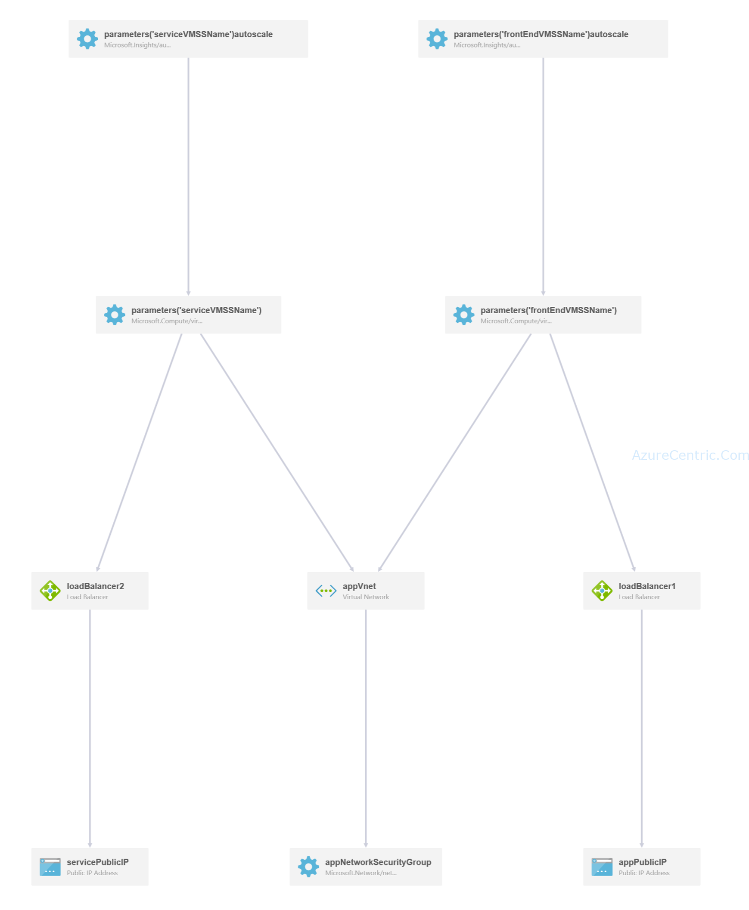

When it comes to best practices to how to setup multiple virtual machines using a load balanced and availability set, the information out there is either outdated or hard to find.

What is the scenario? Imagine that you need to set a few VMs that need to be shared the configuration and some files between them. How you could do it?

After a few searches on the web, I come across with the [IIS and Azure Files](https://blogs.iis.net/davidso/azurefile) blog post. Although this post is dated of October 2015, and as you know, Azure is changing in a very fast pace. My first though was, is this still applicable? After a few tests on my test environment, I found that it’s! Surprisingly! So, if you follow all the steps in the post you may configured your environment.

In my case, there was a specific requirement that this approach wasn’t applicable. My workloads required low latency. So, I went again searching how I could achieve this. And then I found the solution on GitHub! Microsoft publish a template that the only thing you need is fill the blanks. THANK YOU!

This is the template that I’m referring too, [201-vmss-win-iis-app-ssl](https://github.com/Azure/azure-quickstart-templates/tree/master/201-vmss-win-iis-app-ssl).

## **Solution overview and deployed resources**

This template will create the following Azure resources

1. A VNet with two subnets. The VNet and the subnet IP prefixes are defined in the variables section i.e. appVnetPrefix, appVnetSubnet1Prefix & appVnetSubnet2Prefix respectively. Set these two accordingly.
2. A NSG to allow http, https and rdp access to the VMSS. The NSG is assigned to the subnets.
3. Two NICs, two Public IPs and two VMSSs with Windows Server 2012 R2
  1. The first VMSS is used for hosting the WebSite and the 2nd VMSS is used for hosting the Services (WebAPI/WCF etc.) 
  2. The VMSSs are load balanced with Azure load balancers. The load balancers are configured to allow RDP access by port ranges 
  3. The VMSSs are configured to auto scale based on CPU usage. The scaled out instances are automatically configured with Windows features, application deployment packages, SSL Certificates, the necessary IIS sites and SSL bindings
4. The 1st VMSS is deployed with a pfx certificate installed in the specified certificate store. The source of the certificate is stored in an Azure Key Vault
5. The DSC script configures various windows features like IIS/Web Role, IIS Management service and tools, .Net Framework 4.5, Custom login, request monitoring, http tracking, windows auth, application initialization etc.
6. DSC downloads Web Deploy 3.6 & URL Rewrite 2.0 and installs the modules
7. DSC downloads an application deployment package from an Azure Storage account and installs it in the default website
8. DSC finds the certificate from the local store and create a 443 binding
9. DSC creates the necessary rules, so any incoming http traffic gets automatically redirected to the corresponding https end points

The following resources are deployed as part of the solution

## A VNet with two subnet

The VNet and the subnet IP prefixes are defined in the variables section i.e. appVnetPrefix, appVnetSubnet1Prefix & appVnetSubnet2Prefix respectively. Set these two accordingly.
 	
* NSG to define the security rules - It defines the rules for http, https and rdp acces to the VMSS. The NSG is assigned to the subnets 	
* Two NICs, two Public IPs and two VMSSs with Windows Server 2012 R2 	
* Two Azure load balancers one each for the VMSSs
* A Storage accounts for the VMSS as well as for the artifacts

## Prerequisites

1. You should have a custom domain ready and point the custom domain to the FQDN of the first public IP/Public IP for the Web Load balancer
2. SSL certificate: You should have a valid SSL certificate purchased from a CA or be self signed
3. Create an Azure KeyVault and upload the certificate to the KeyVault. Currently, Azure KeyVault supports certificates in pfx format. If the certificates are not in pfx format then import those to a windows cert store on a local machine and then export those to a pfx format with embeded private key and root certificate.

Cheers,

**Marcos Nogueira**  
**_Azure MVP_**  
[azurecentric.com](http://azurecentric.com)  
Twitter: [@mdnoga](http://www.twitter.com/mdnoga)
