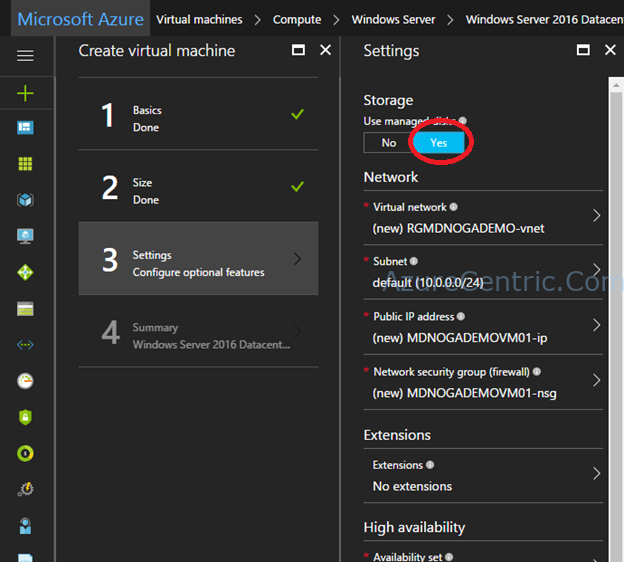
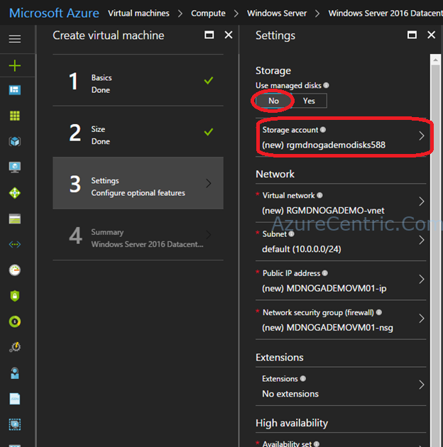

You probably already saw this when you are creating a Virtual Machine on Azure. After you insert the basic information like Name of the VM, choose the size, then comes the time to define and configure the settings of that VM. One of the first thing is the Use of managed disk.

But what is managed disks? How they work? What are the implication of using the Managed disks?

So, first thing, Managed Disk allow you to abstract the storage accounts where you will use on your virtual machine (see pictures below). When you select that you want to use managed disk, you don’t have to setup or choose the storage account where those disks will be stored.

When you don’t want to use Managed disks, you have to select the storage account.

With Managed disk, you only have to specify the size of the disk, and Azure manage for you. That allows you more granular access control. You don’t have to care with the storage account limits and you will gain higher scalability, meaning that you can create up to 10000 disks per region per subscription.

Managed disk will increase your resilience for your availability sets, by making sure that the disk will belong to a storage unit that is on a different fault domain. In my experience, when you create storage account, it’s not guarantee that your storage account will be on a different fault domain. That scenario, even if you use availability sets on the setup, doesn’t avoid a single point of failure.

But if you are thinking, that you prefer to use storage accounts, to control the access to the VHDs, with managed disks you can use RBAC as well, to assign the permissions for a managed disk to one or more users. In this scenario, you have to managed disk by disk, and not to the entire storage account. That means more granular access control. You can prevent, for example, a user of copy that vhd, but still use the virtual machine.

The integration with Azure Backup is great. You can use Azure Backup Service with managed disk to create a backup job that will easy your VM restoration. Managed disks although, only support the Locally Redundant Storage (LRS) as a replication option, this mean that 3 copies of the vhd within the region.

To resume, here are the benefits of managed disks:

* Simple and scalable VM deployment 	
* Better reliability for Availability Sets 	
* Granular Access control
* Azure Backup service support

Cheers,

**Marcos Nogueira**  
**_Azure MVP_**  
[azurecentric.com](http://azurecentric.com)  
Twitter: [@mdnoga](http://www.twitter.com/mdnoga)
