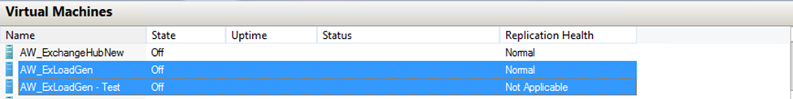

The Hyper-V Manager interface is used to manage standalone Hyper-V Primary, Replica servers, and the virtualized workloads running on those servers. The Failover Cluster Manager interface is used if the Primary or Replica servers are part of a Hyper-V Failover Cluster. Hyper-V Replica management tasks can be categorized as follows:	
  * Hyper-V Server Primary Site Management Tasks
  * Hyper-V Server Replica Site Management Tasks
  * Virtual Machine Primary Site Management Tasks
  * Virtual Machine Replica Site Management Tasks
  * Modifying Virtual Machine Replication Settings
  **Note:** In the above list, Hyper-V Failover Cluster can be substituted for 'Hyper-V Server'.

## Hyper-V Server Primary Site

Management tasks involving the Hyper-V Server at a Primary Site include:

**Ensure the Hyper-V server (Hyper-V Failover Cluster) at the Primary site is configured as a Replica server to support Reverse Replication for a Planned Failover event**

To configure the Hyper-V server at the Primary site as a Replica server:
  1. In the **Hyper-V Manager** interface, Click on **Hyper-V Settings** in the Actions pane
  2. In the **Hyper-V Settings** dialog box, Click on **Replication Configuration**
  3. In the **Details** pane, Select **Enable this computer as a Replica server**
  4. Choose an **Authentication **method to include the port that will be used (if not using the default port)
  5. Configure **Authorization and storage**.  This includes designating a specific location to store replica virtual machine files if the default location is not to be used.  Should you not desire to allow all Hyper-V Primary servers to be serviced, you have the option to allow only specific Hyper-V servers (Primary servers) to send replication requests. Click **Apply** or **OK** when finished
  **Note:**  In a Replica cluster, use the Hyper-V Replica Broker role to configure the cluster nodes for replication.

### **Monitor the Replication Health of virtual machines configured for replication**

To monitor the Replication Health of a virtual machine configured for replication:
  1. Open Hyper-V Manager
  2. In the details pane, Right-click on one of the Column Headings and select **Add\Remove Columns**
  3. Choose **Replication Health** in the **Available Columns** list, click **Add** to move it to the **Displayed Columns** list
  4. Move the new column to the desired location in the listing and click **OK**

### **Monitor Hyper-V Replica specific Performance counters using Performance Monitor**

To monitor Hyper-V Replica performance:
  1. Click the **Start button,  **then** **click **Run** and type** perfmon.msc** and press ENTER
  2. In the navigation tree, expand **Monitoring Tools**, and then click **Performance Monitor**
  3. In the menu bar above the Performance Monitor graph display, either click the **Add **button (+) or right-click anywhere in the graph and click **Add counters** from the menu. The **Add Counters** dialog box opens
  4. In the **Available Counters** section, select counters to view in the Performance Monitor display.  The counters for Hyper-V Replica are virtual machine specific and are listed under **Hyper-V F Counter VM**
  5. Choose the desired counters and instances (virtual machines) then click the **Add** button to add the counters
  6. When finished, click **OK**

For more information Performance Monitor, visit the [Performance Monitor Getting Started Guide](http://technet.microsoft.com/en-us/library/dd744567(WS.10).aspx).

### **Evaluate Hyper-V Replica log data using the Microsoft-Windows-Hyper-V-VMMS\Admin log**

To review Hyper-V Replica log data:
  1.  In the **Server Manager** **Menu Bar**, **Click** on **Tools** and choose **Event Viewer** from the list
  2. In the navigation tree, expand **Application and Services Logs**,  expand **Microsoft**, expand **Windows**, expand **Hyper-V-VMMS**
  3. Click on ****Admin**** 

Hyper-V Replica event messages are registered in the Hyper-V-VMMS channel.

## Hyper-V Server Replica Site

Management tasks involving the Hyper-V Server at a Replica Site include:

**Ensure the Hyper-V server (Hyper-V Failover Cluster) at the Replica site is configured as a Replica server**

To configure the Hyper-V server at the Primary site as a Replica server:
  1. In the **Hyper-V Manager** interface, Click on **Hyper-V Settings** in the Actions pane
  2. In the **Hyper-V Settings** dialog box, Click on **Replication Configuration**
  3. In the **Details** pane, Select **Enable this computer as a Replica server**
  4. Choose an **Authentication **method to include the port that will be used (if not using the default port)
  5. Configure **Authorization and storage**.  This includes designating a specific location to store replica virtual machine files if the default location is not to be used.  Should you not desire to allow all Hyper-V Primary servers to be serviced, you have the option to allow only specific Hyper-V servers (Primary servers) to send replication requests. Click **Apply** or **OK** when finished
  **Note:**  In a Replica cluster, use the Hyper-V Replica Broker role to configure the cluster nodes for replication.

### **Monitor the Replication Health of virtual machines configured for replication**

To monitor the Replication Health of a virtual machine configured for replication:
  1. Open Hyper-V Manager
  2. In the details pane, Right-click on one of the Column Headings and select **Add\Remove Columns**
  3. Choose **Replication Health** in the **Available Columns** list, click **Add** to move it to the **Displayed Columns** list
  4. Move the new column to the desired location in the listing and click **OK**

### **Monitor Hyper-V Replica specific Performance counters using Performance Monitor**

To monitor Hyper-V Replica performance:
  1. Click the **Start button,  **then** **click **Run** and type** perfmon.msc** and press ENTER
  2. In the navigation tree, expand **Monitoring Tools**, and then click **Performance Monitor**
  3. In the menu bar above the Performance Monitor graph display, either click the **Add **button (+) or right-click anywhere in the graph and click **Add counters** from the menu. The **Add Counters** dialog box opens
  4. In the **Available Counters** section, select counters to view in the Performance Monitor display.  The counters for Hyper-V Replica are virtual machine specific and are listed under **Hyper-V Replica  Counter VM**
  5. Choose the desired counters and instances (virtual machines) then click the **Add** button to add the counters
  6. When finished, click **OK**

For more information Performance Monitor, visit the [Performance Monitor Getting Started Guide](http://technet.microsoft.com/en-us/library/dd744567(WS.10).aspx).

**Evaluate Hyper-V Replica log data using the Microsoft-Windows-Hyper-V-VMMS\Admin log**

To review Hyper-V Replica log data:
  1. In the **Server Manager** **Menu Bar**, **Click** on **Tools** and choose **Event Viewer** from the list
  2. In the navigation tree, expand **Application and Services Logs**,  expand **Microsoft**, expand **Windows**, expand **Hyper-V-VMMS**
  3. Click on **Admin**

Hyper-V Replica event messages are registered in the Hyper-V-VMMS channel.

## Virtual Machine - Primary Site

Management tasks involving virtual machines at the Primary Site include:

### **Planned Failover** 
This action initiates a failover of a virtual machine from a Primary to a Replica server.  This is a 'planned' event as opposed to a **Failover **action, which is unplanned.  Since it is a 'planned' event, there should be no data loss.  This action executes a series of checks prior to executing the failover.  One check determines if the Primary server has also been configured as a Replica server.  This is done because the assumptions are first, the virtual machine being failed over to a Replica server will eventually be moved back to the Primary server and second, the Primary server will become the Replica server for the virtual machine that is being failed over.  This action provides an Administrator the flexibility to execute the failover of a virtual machine to a replica server in a controlled manner before a disaster occurs

To execute a Planned Failover for a virtual machine:
  1. Open Hyper-V Manager
  2. In the details pane, select a virtual machine
  3. With the virtual machine selected, Right-click and select Replication and then choose **Planned** **Failover**
  4. A list of **Pre-Requisites** and **Actions** is presented.  If the Virtual Machine has not been shut down and the Primary Server not configured as a Replica Server, complete those tasks before proceeding. By default, **Start the replica virtual machine after Failover **is checked (uncheck if this is not the desired action for the virtual machine after a Planned Failover completes)
  5. Click on the **Failover** button.
  6. If the Failover is successful, a pop-up dialog box appears reporting the Failover completed successfully (**Note:** If the option to start the virtual machine after the Planned Failover was left checked, then the virtual machine will be started on the Replica server).  Close the dialog box.
  7. If the Planned Failover does not complete successfully, review the information contained in the **General Methodology for troubleshooting the virtual machine Failover process **in the troubleshooting section.

### **Pause Replication** 
This action pauses replication for the selected virtual machine.  The **Replication Health** column in the Hyper-V Manager interface (if selected for display) reflects a Warning** Status**

To Pause Replication for a virtual machine:
  1. Open Hyper-V Manager
  2. In the details pane, select a virtual machine that is not paused
  3. With the virtual machine selected, Right-click and select **Replication** and then choose **Pause Replication**
  4. The **Replication Health**, if visible, in Hyper-V Manager, will be updated and the **Replication Health** for the virtual machine will indicate a **Warning**.  The **State** column still shows the Virtual Machine as Running
  5. Right-click on the Virtual Machine, select **Replication** and then click on **View Replication Health**.  The health report reflects an accurate **Replication State** which should be **Replication Paused**

### **Resume Replication** (Available only if replication has been paused for a virtual machine) 
This action resumes replication for the selected virtual machine (the action must be executed in the same site where replication was **Paused**).  The Hyper-V Replica Network Services component re-establishes a connection to the Replica server (if needed) and replication resumes.  If the virtual machine was in a **Resynch Required** state, **Resume Replication** performs a resynchronization.  A resynchronization essentially compares blocks between the Primary and Replica VHDs and then sends the delta blocks to the Replica. Scenarios where this can happen include, but may not be limited to, a failure occurred on the Primary server when changes were being made to the replication log or, if the Primary is a Failover Cluster, an unplanned cluster failover occurred.  The **Replication Health** column in Hyper-V Manager interface (if selected for display) reflects a status of **Normal**

To Resume Replication for a virtual machine:
  1. Open Hyper-V Manager
  2. In the details pane, select a paused virtual machine
  3. With the virtual machine selected, Right-click and select **Replication** and then choose **Resume Replication**
  4. ****The **Replication Health**, if visible, in Hyper-V Manager, is updated and the **Replication Health** for the virtual machine is **Normal**

### **View Replication Health** 
This action provides data about the replication events for a virtual machine.

A Replication Health Report can be saved as a CSV file.  A Replication Health Report indicates if it is being viewed as either a Primary or a Replica virtual machine (see a sample of a Replication Health Report on a Replica virtual machine later in this guide)

To view Replication Health for a virtual machine:
  1. Open Hyper-V Manager
  2. In the details pane, select a virtual machine
  3. With the virtual machine selected, Right-click and select **Replication **and then choose **View Replication Health**
  4. ****The **Replication Health Report** for the virtual machine is displayed. The report can be saved as a CSV file by clicking on **Save as … **Button

### **Remove Replication** 
This action stops replication for the virtual machine.  All connections for the virtual machine to the Replica server are terminated.  The **Replication Health** in Hyper-V Manager on the Primary server, if selected for viewing, is **Not Applicable**.  A corresponding action must be accomplished on the Replica server.  Failure to execute this same action on the Replica server will result in errors should a Hyper-V Administrator attempt to re-enable replication for the virtual machine (more information is provided in the Troubleshooting section)

To Remove Replication for a virtual machine:
  1. Open Hyper-V Manager
  2. In the details pane, select a virtual machine
  3. With the virtual machine selected,  Right-click and select **Replication** and choose **Remove Replication**
  4. Acknowledge the pop-up **Warning** by clicking on **Remove Replication**
  5. The **Replication Health** column, if displayed, indicates **Not Applicable** for the virtual machine
  6. Connect to the Replica server and execute Steps 1-5.  This will remove replication for the virtual machine on the Replica server and will initiate a merge for all the replica information for the virtual machine
  7. The **Replication Health** column, if displayed, indicates **Not Applicable** for the virtual machine
  8. Additional cleanup action is required on the Replica server.  In Hyper-V Manager, Right-click on the virtual machine and choose **Delete**.  Acknowledge the pop-up **Warning** by clicking on **Delete.  **This removes the virtual machine reference in Hyper-V Manager.  Some data files remain on the Replica server in the storage location specified for the replication data.  To recover storage space, manually remove the data.

### **Enable Replication** (Available only if replication is not enabled for a virtual machine) 
This action enables replication for a virtual machine

To Enable Replication for a virtual machine:
  1. Open Hyper-V Manager
  2. In the details pane, select a virtual machine
  3. With the virtual machine selected,  Right-click and select **Enable Replication**
  4. Review the information in the **Before You Begin** screen and click **Next**
  5. In the **Specify Replica Server** screen, provide the name for the **Replica Server** using the Fully Qualified Domain Name (FQDN) or NetBIOS format.   There is also the option to Browse Active Directory for the server.  If the Replica Server is configured correctly, the **Specify Connection Parameters** screen is populated.  If not, an error is registered and an option to **Configure Server** is available to configure the server to be a Replica Server. If data compression is not desired, **Uncheck** the box **Compress the data that is transmitted over the network**. Click **Next**
  6. In the **Choose Replication VHDs** screen, ensure all disks to be replicated are **Checked** and then click **Next **(i.e. uncheck those disk you do not want replicated.  An example might be a disk functioning as a repository for the virtual machine page file)
  7. In the **Configure Recovery History** screen, select as desired. For an explanation of the options, review the section on **Enabling a virtual machine for replication**.  Click **Next**
  8. In the **Choose Initial Replication Method** screen, select as desired. For an explanation of the options, review the section on **Enabling a virtual machine for replication**.  Click **Next**
  9. Review the information in the** Summary screen, **and click **Finish**

Once replication has been enabled for a virtual machine, the **Replication Health** column, if visible, in Hyper-V Manager will be updated.  Once the Initial Replication (IR) has been completed, the **Replication Health** for a virtual machine will be** Normal**.

## Virtual Machine - Replica Site

Management tasks involving virtual machines at the Replica Site include:

### **Failover** 
This action executes a process that starts a virtual machine on the Replica server using a replica (Recovery Point) selected by the Hyper-V Administrator.  This is an unplanned event unlike the Planned Failover action, which is a planned event.  Executing a Failover for a virtual machine could result in data loss depending on which recovery point is selected

To Failover a virtual machine:
  1. Open Hyper-V Manager
  2. In the details pane, select a virtual machine
  3. With the virtual machine selected,  Right-click and select **Replication** and then choose **Failover**
  4. In the next screen, choose a recovery point from the drop-down listing of all the recovery points associated with the virtual machine and then click **Failover**
  5. The virtual machine starts and the **Replication Health** indicates **Warning**. If the Primary server remains the same, the **Replication Health** for the virtual machine that was recovered is also **Warning**. To complete the process and remove the **Warnings**, either **Cancel Failover** or configure **Reverse Replication** and allow Initial Replication to complete. If a new Replica Server is needed, configure **Reverse Replication** to the new Replica server.

### **Test Failover** 
This action allows a Hyper-V Administrator to test a virtual machine on the Replica server without interrupting the production workload running on the Primary server.  The network configuration for the test virtual machine is disconnected by default so as not to interfere with the production workload. If network connectivity is to be tested, the recommendation is to create a separate test network and connect the test virtual machine to that network. The virtual machine created and started has the same name as the original virtual machine with a modifier of **Test** added on to the end

To start a Test Failover for a virtual machine:	
  1. Open Hyper-V Manager
  2. In the details pane, select a virtual machine
  3. With the virtual machine selected, Right-click and select **Replication** and then choose **Test Failover**
  4. In the next screen, choose a recovery point from the drop-down listing of all the recovery points associated with the virtual machine and then click **Test Failover**. A new test virtual machine is created but is not started. At this point, the virtual machine can be started and then a connection can be made to the virtual machine and a verification process can be completed

### **Stop Test Failover** (Available only if a test is already running for the selected virtual machine) 
This action stops a test that is in progress for the selected virtual machine.  The virtual machine is stopped and deleted from Hyper-V Manager (**Note:** If the Test Failover is being executed on a Replica cluster, the Test-Failover role that is created in Failover cluster Manager will have to be manually deleted)

To stop a Test Failover for a virtual machine:
  1. Open Hyper-V Manager
  2. In the details pane, select the virtual machine being tested, not the test virtual machine that is running. Right-click on the virtual machine, select **Replication** and then choose **Stop Test Failover**
  3. ****The test** **virtual machine is stopped if it is running and is removed from Hyper-V Manager as the test is completed

### *Pause Replication** 
This action pauses replication for the selected virtual machine. The **Replication Health** column in Hyper-V Manager, if selected for viewing, indicates a Warning

To Pause Replication for a virtual machine:
  1. Open Hyper-V Manager
  2. In the details pane, select a virtual machine that is not paused
  3. With the virtual machine selected, Right-click and select **Replication** and then choose **Pause Replication**
  4. ****The **Replication Health**, if visible, in Hyper-V Manager, is updated and indicates** a **Warning

### **Resume Replication** (Available only if replication has been paused for a virtual machine on the Replica server) 
This action resumes replication for the selected virtual machine.  If a 'resynch' is required for the virtual machine, that action will be initiated on the Primary server.  The **Replication State** column, if selected for viewing in Hyper-V Manager, indicates **Replication Enabled**

To Resume Replication for a virtual machine:
  1. Open Hyper-V Manager
  2. In the details pane, select a paused virtual machine
  3. With the virtual machine selected, Right-click and select **Replication** and then choose **Resume Replication**
  4. ****The **Replication Health**, if visible, in Hyper-V Manager, is updated and indicates Normal

### **View Replication Health** 
This action provides data about the replication events for a virtual machine.

A **Replication Health Report** can be saved as a CSV file.  A **Replication Health Report** indicates if it is being viewed on either a Primary or a Replica server

To View Replication Health for a virtual machine:	
  1. Open Hyper-V Manager
  2. In the details pane, select a virtual machine
  3. With the virtual machine selected, Right-click and select **Replication **and then choose **View Replication Health**
  4. The **Replication Health Report** for the virtual machine is displayed. The report can be saved as a CSV file by clicking on **Save as…**

### **Remove Replication** 
If a Remove Replication action is executed on the Replica server, a corresponding action must be executed on the Primary Server. This action stops replication for the virtual machine.  Prior to re-enabling replication, the virtual machine must be deleted in Hyper-V Manager on the Replica server.  This destroys the virtual machine on the Replica Server.  If the virtual machine is not deleted, a **Replication error** is reflected in Hyper-V Manager and associated error logs are registered (more information is provided in the Troubleshooting section)

To Remove Replication for a virtual machine:	
  1. Open Hyper-V Manager
  2. In the details pane, select a virtual machine
  3. With the virtual machine selected,  Right-click and select **Replication** and then choose **Remove Replication**
  4. Acknowledge the pop-up **Warning** by clicking on **Remove Replication**
  5. The **Replication Health** column, if displayed, indicates Not Applicable
  6. A process will start to merge all recovery point data into the VHD that was initially replicated
  7. Connect to the Primary server.  In Hyper-V Manager, the virtual machine **Replication Health **indicates **Normal**
  8. Execute Steps 1-5.  This removes replication for the virtual machine on the Primary server
  9. The **Replication Health** column, if displayed, now indicates Not Applicable** **on the Primary server.  If Step 8 is not accomplished before the next 5 minute replication interval, **Replication Health** will indicate **Critical**
  10. Additional cleanup action is required on the Replica server. In Hyper-V Manager, Right-click on the virtual machine and choose **Delete**.  Acknowledge the pop-up **Warning** by clicking on **Delete.  **This removes the virtual machine reference in Hyper-V Manager.  Some data files remain on the Replica server in the storage location specified for the virtual machine.  To recover storage space, manually remove this data

### **Cancel Failover **
This action is available if a **Failover** action was executed for a virtual machine. This allows a Hyper-V Administrator to cancel the **Failover** action if, for example, he decides the recovery point chosen was not the desired one.  After cancelling the **Failover**, another recovery point can be selected and another **Failover** process initiated. A Failover can only be cancelled if the virtual machine state is **Failed over - Waiting Completion**. If a **Reverse Replication** has been completed, the **Failover** can no longer be cancelled

To Cancel Failover for a virtual machine:
  1. Open Hyper-V Manager
  2. In the details pane, select a virtual machine that has a **Replication Health **of **Warning but viewing the Health Report **shows Failover Complete
  3. With the virtual machine selected,  Right-click, select **Replication** and then choose **Cancel Failover**
  4. Acknowledge the pop-up **Warning** by clicking on **Yes. ** On the Replica server, the virtual machine is turned off and the **Replication Health** indicates Normal**.  **On the Primary server, the **Replication Health** shows** **Critical.
  5. To clear the **Critical health state**,  right-click on the virtual machine and select **Replication** and then choose **Resume Replication**

### **Reverse Replication ** 
This action is available if a **Failover** action was executed for a virtual machine.  This allows the Hyper-V Administrator to designate a Hyper-V server as a Replica server for the virtual machine that was recovered

To enable Reverse Replication for a virtual machine:
  1. Open Hyper-V Manager
  2. In the details pane, select a virtual machine that has a **Health **of **Warning**
  3. With the virtual machine selected, Right-click, select **Replication**, and then choose Remove Recovery Points**.  ** This merges all the recovery points into the original VHD.  This completes Failover but Replication Health still indicates **Warning**
  4. With the virtual machine selected, Right-click, select Reverse Replication
  5. Complete the **Reverse Replication** wizard by either selecting the Primary server (the default) as the Replica y server or choosing another Replica server.  Keep in mind that if the selected Hyper-V server has not been enabled as a Replica server and the appropriate firewall rule enabled, the **Reverse Replication** process will fail.

### **Remove Recovery Points** 
This action is available only during a Failover scenario.  When this action is executed, all recovery points (snapshots) for a Replica virtual machine are deleted.  When the action is executed, a pop-up dialog box is presented to the user indicating all recovery points will be removed and **Cancel Failover** will no longer be available.  The user must acknowledge the pop-up by clicking either **Yes** or **No**.  If **Yes** is selected, the Failover is committed and the recovery points are merged down into the base VHD for the virtual machine.  At this point **Reverse Replication** can be configured to clear the **Warning** for **Replication Health** and an Initial Replication can begin to the new Replica Server

Cheers,

**Marcos Nogueira**
[azurecentric.com](http://azurecentric.com)
Twitter: [@mdnoga](http://www.twitter.com/mdnoga)
