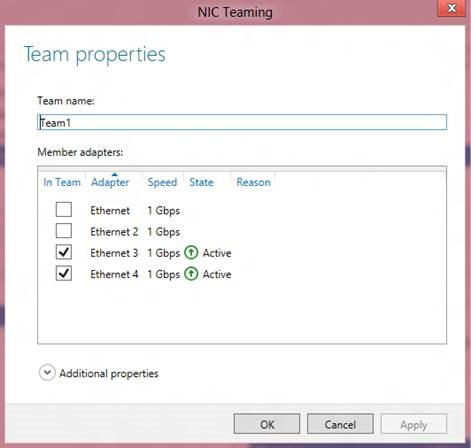
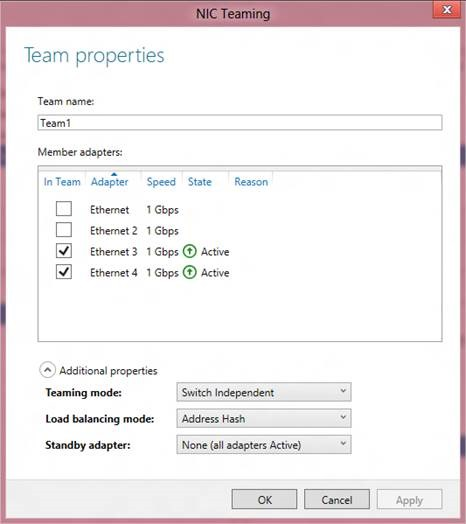
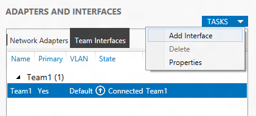
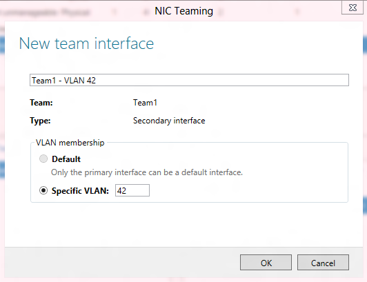
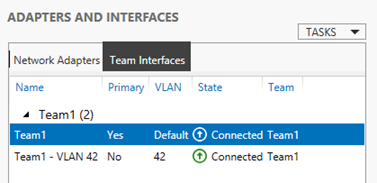
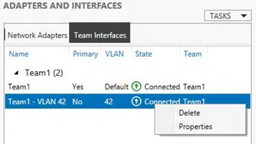
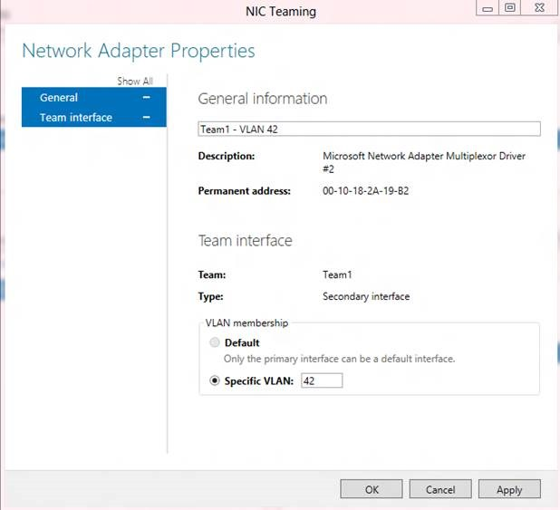
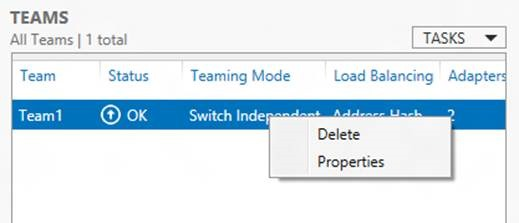

## Modifying a team through the UI

Within the UI, modifications to the team can be done by selecting a team in the Team tile, right-clicking on the team, and selecting the Modify Team action. Selecting Modify Team will pop-up the Team properties dialog box. This dialog box is very similar to the  

In the Team properties dialog box the following actions can be accomplished:  
  * Rename the team: Select the team name and edit it.  
  * Add team members: Select additional adapters from the Member Adapters tile  
  * Remove team members: De-select adapters from the Member Adapters tile. At least one adapter must be selected. 



If the Additional properties drop-down item is selected then the Teaming mode and Load distribution mode may also be modified. This Additional properties drop-down also allows the administrator to select a standby adapter when active-standby mode is desired.  

  

## Modifying a team through Windows PowerShell

### Renaming a team

To rename Team1 and give it the name TeamA, the Windows PowerShell is:  
```powershell
Rename-NetLbfoTeam Team1 TeamA  
```
### Changing the teaming mode

The Windows PowerShell options for teaming mode are:  
  * SwitchIndependent  
  * Static  
  * LACP

To change Team1 to an 802.1ax LACP team, the Windows PowerShell is:  
```powershell
Set-NetLbfoTeam Team1 ‑TeamingMode LACP 
```
The “-TeamingMode” flag can be abbreviated “-TM”, as in  
```powershell
Set-NetLbfoTeam Team1 –TM LACP  
```
  **_Note_**: For security reasons teams created in VMs may only operate in SwitchIndependent mode.  

### Changing the load distribution algorithm

The Windows PowerShell options for load distribution algorithm are:  
  * TransportPorts  
  * IPAddresses  
  * MacAddresses  
  * HyperVPort

To change Team1’s Load balancing algorithm to Hyper-V Ports, the Windows PowerShell is:  
```powershell
Set-NetLbfoTeam Team1 ‑LoadBalancingAlgorithm HyperVPorts  
```
The “-LoadBalancingAlgorithm” flag can be abbreviated “-LBA”, as in  
```powershell
Set-NetLbfoTeam Team1 ‑LBA HyperVPorts  
```
To change the Teaming mode and Load balancing algorithm at the same time,  
```powershell
Set-NetLbfoTeam Team1 ‑TM LACP ‑LBA HyperVPorts  
```
  **_Note_**: Teams created in VMs may not use the HyperVPort load distribution algorithm.  

### Adding new members to the team

To add NIC1 to Team1 the Windows PowerShell command is:  
```powershell
Add-NetLbfoTeamMember NIC1 Team1  
```
### Removing members from the team

To remove NIC1 from Team1 the Windows PowerShell command is:  
```powershell
Remove-NetLbfoTeamMember NIC1 Team1  
```
### Setting a team member to be the Standby Adapter

A team member can be set as the Standby Adapter through Windows PowerShell:  
```powershell
Set-NetLbfoTeamMember NIC4 -AdministrativeMode Standby  
```
At most one team member may be in standby mode at any point in time. If a different team member is already in standby mode that team member must be returned to active mode before this Windows PowerShell cmdlet will succeed.  

### Adding new interfaces to the team

To add a new interface to the team select the Team in the Teams Tile and the Team Interfaces tab in the Adapters and Interfaces tile. Select the Tasks menu in the Adapters and Interfaces tile, then select Add Interface.  

  

Selecting the Add Interface action item pops-up the New team interface dialog box.  

  

Since only one team interface, the primary team interface, can be in Default mode, the new team interface **must **have a specific VLAN value. As the specific VLAN value is entered the name of the interface will be modified to be the team name followed by the VLAN value of this team interface. The interface name can be modified to any other name (duplicates are not allowed) if the administrator chooses to do so.  

Selecting OK will create the new team interface.  

  

The Windows PowerShell to add a team interface with VLAN 42 to Team1 is  
```powershell
Add-NetLbfoTeamNIC Team1 42  
```
### Modifying team interfaces

There are only two modifications that can be done to a team interface:  
  * change the team interface name and/or  
  * change the VLAN ID. 

To modify the team interface VLAN ID select and then right-click the team interface in the Team Interfaces tab. Select the Properties action item.  

  

This pops-up the Network Adapter Properties dialog box. This dialog box has some useful information about the team interface. It also has the box where the new VLAN ID can be entered. If a new VLAN ID is entered and the team name is the one the system provided when the team interface was created the team interface name will be changed to reflect the new VLAN ID. If the team interface name has been previously changed then the team name will not be changed when the new VLAN ID is entered.  

  

To modify a team interface’s VLAN ID in Windows PowerShell  
```powershell
Set-NetLbfoTeamNIC “Team1 ‑ VLAN 42” -VlanID 15 
```
Just as in the UI, changing the VLAN ID will cause the team interface name to change if the team interface name is still the same as the one the system created when the team interface was created. I.e., if the team interface name is <teamName ‑ VLAN xx> where xx is the VLAN ID of the team interface, then the VLAN ID portion of the team interface name will be modified to reflect the new VLAN ID.  

### Removing interfaces from the team

To delete a team interface, select and then right-click the team interface in the Team Interfaces tab. Select the Delete team interface action item. A confirmation dialog box will pop-up. Once confirmed the team interface is deleted.  

The Primary team interface (i.e., the one that was created when the team was created) can’t be deleted except by deleting the team.  

To delete a team interface in Windows PowerShell  
```powershell
Remove-NetLbfoTeamNIC “Team1 ‑ VLAN 42” 
```
## Deleting a team

To delete a team from the server select the team in the Teams tile. Right-click the team and select the Delete team action item.  

  

A confirmation dialog box will be displayed. Once confirmed the team will be deleted.  

To delete a team in Windows PowerShell  
```powershell
Remove-NetLbfoTeam Team1  
```
To remove all teams from the server in Windows PowerShell (i.e., to clean up the server),  
```powershell
Get-NetLbfoTeam | Remove-NetLbfoTeam
```

Cheers,

**Marcos Nogueira**
[azurecentric.com](http://azurecentric.com)
Twitter: [@mdnoga](http://www.twitter.com/mdnoga)
