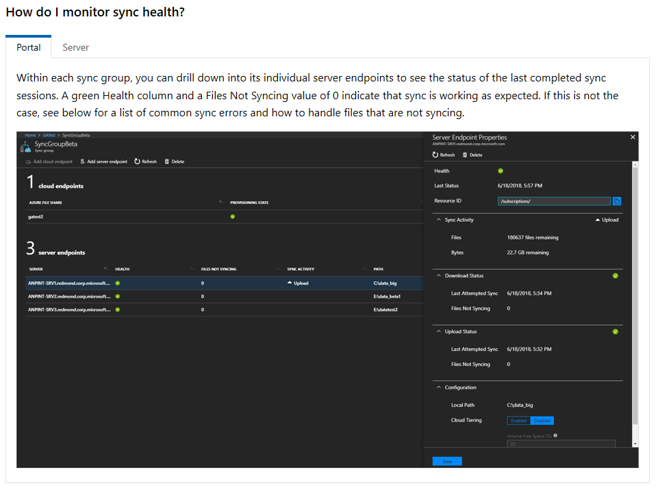
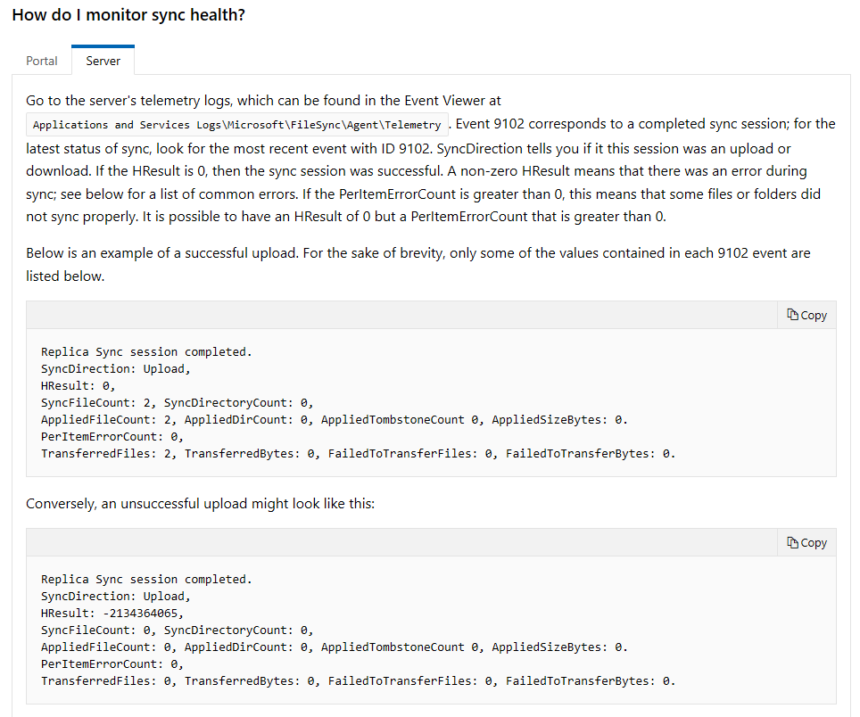
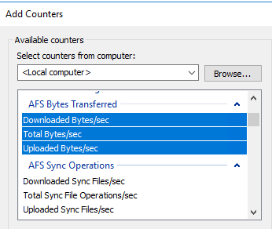
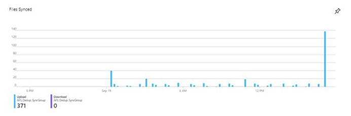
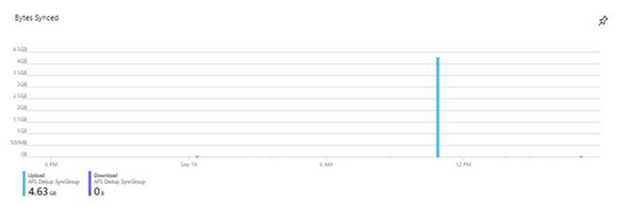

After implementing Azure File Sync, you wonder, how I can monitor what I just implemented? My first thought was to investigate in the Azure Resource himself,
to look the sync service and see whether there are any diagnostics settings which can be enabled in order to send logs to Log Analytics where we could set
up alerts. However, there weren`t any diagnostics options on the Azure resource, so I then looked in the documentation: [https://docs.microsoft.com/en-us/azure/storage/files/storage-sync-files-troubleshoot?tabs=portal1%2Cazure-portal#sync](https://docs.microsoft.com/en-us/azure/storage/files/storage-sync-files-troubleshoot?tabs=portal1%2Cazure-portal#sync)

Using the portal is not ok, if you want something ongoing with more of the “enterprise look” (like receive email, alerts, so on), although it’s fine for an interactive ad-hoc checks.

The second option presented at the documentation, is event logs on the servers where the Sync Service is installed.

For Azure File Sync, Microsoft is continuing working on Azure Monitor integration (view metrics, logs and configure alerts). Microsoft recently added some additional metrics in Azure Monitor (see details below) and they will continue to add more in a very near future. Logging and alerts should be available by later this year.

Then I decide to dive deep and see how we can monitor Azure File Sync. These are some of the monitoring options are available today:

## **Monitoring Option #1: Azure Portal**

Use the portal to view the Registered server state and Server endpoint health (sync health). These are the components of the Azure File Sync that you should
monitor:

**Registered Server State**

- If **Registered server state = Online**, then the server is successfully communicating with the service.
- If **Registered server state = Offline** or **Appears Offline**, verify if the Storage Sync Monitor (AzureStorageSyncMonitor.exe) process on the server is running.   
    **NOTE:** If the server is behind a Firewall or Proxy, configure the firewall and proxy.

**Server Endpoint Health**

- The server endpoint health in the portal is based on the sync events that are logged in the Telemetry event log on the server (ID 9102 and 9302). If a sync session fails due a transient error (e.g., error cancelled), sync may still show healthy in the portal as long as the current sync session is making progress (Event ID 9302 is used to determine if files are being applied).
- If the portal shows a sync error due to sync not making progress, then you need to troubleshoot the issue, I recommend to check the [Troubleshooting Sync Error](https://na01.safelinks.protection.outlook.com/?url=https%3A%2F%2Fdocs.microsoft.com%2Fen-us%2Fazure%2Fstorage%2Ffiles%2Fstorage-sync-files-troubleshoot%3Ftabs%3Dportal1%252Cportal%23common-sync-errors&data=02%7C01%7Cjeffpatt%40microsoft.com%7Cec7d7a367f524144709308d65a6f43a6%7C72f988bf86f141af91ab2d7cd011db47%7C1%7C0%7C636795831267117929&sdata=uDbu1u8VzHN8BFGJZjkdHPpf4wu4E6ArhHgnT%2FHHGqo%3D&reserved=0) for guidance.

## **Monitoring Option #2: Use Telemetry event logs on the Windows Server **

Use the Telemetry event logs to monitor registered server, sync, and cloud tiering health. The Telemetry even logs are located under **Applications and Services>Microsoft>FileSync>Agent** in Event Viewer

**Sync**

- **Event ID 9102** is logged once a sync session completes. This event should be used to determine if sync sessions are completing successfully (HResult = 0) and if there are per-item sync errors.
- **Event ID 9302** is logged every 5 to 10 minutes if there’s an active sync session. This event should be used to determine if the current sync session is making progress (AppliedItemCount > 0). If sync is not making progress, then the sync session should eventually fail and an Event ID 9102 will be logged with the error. 

**Registered Server Health**

- **Event ID 9301** is logged every 30 seconds when a server queries the service for any jobs. If GetNextJob completes with status = 0, then the server is able to communicate with the service. 

**Cloud Tiering**

- Tiering 
  - Use Event ID 9002, 9003, 9016 and 9029 to monitor tiering activity and errors. 
- Recall 
  - Use Event ID 9005, 9006, 9007 to monitor recall activity and errors. 

## **Monitoring Option #3: Use Azure File Sync performance counters**

Use the Azure File Sync performance counters to monitor sync activity.

**Current Performance counters**
-  AFS Bytes Transferred 
  - Downloaded Bytes/sec
  - Total Bytes/sec
  - Uploaded Bytes/sec
- AFS Sync Operations 
  - Downloaded Sync Files/sec
  - Total Sync File Operations/sec
  - Uploaded Sync Files/sec

## **Monitoring Option #4 - Portal: Azure Monitor integration **

The initial integration will have charts which provide the following information: Files Synced, Bytes Synced, Files Not Syncing, Sever Heartbeat and Recall Activity 

- The charts will be available soon and can be previewed by using the following URL: [https://portal.azure.com/?Microsoft_Azure_Kailani_ShowCustomerReports=true](https://na01.safelinks.protection.outlook.com/?url=https%3A%2F%2Fportal.azure.com%2F%3FMicrosoft_Azure_Kailani_ShowCustomerReports%3Dtrue&data=02%7C01%7Cjeffpatt%40microsoft.com%7Cec7d7a367f524144709308d65a6f43a6%7C72f988bf86f141af91ab2d7cd011db47%7C1%7C0%7C636795831267167974&sdata=Vw83ypsr1olgzzTOLnRByp28t6Bckza3tPqQXG1LPFA%3D&reserved=0)

- Portal: View Cloud Tiering health 
  - Cloud tiering health will be displayed in the portal (similar to the server endpoint sync health status). 

Cheers,

**Marcos Nogueira**  
**_Azure MVP_**  
[azurecentric.com](http://azurecentric.com)  
Twitter: [@mdnoga](http://www.twitter.com/mdnoga)
