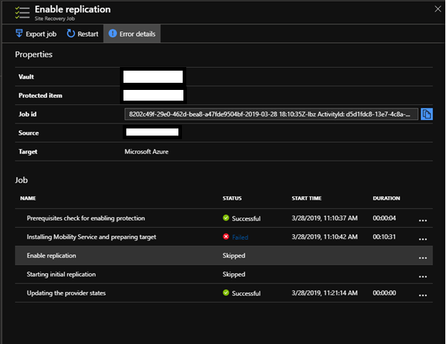
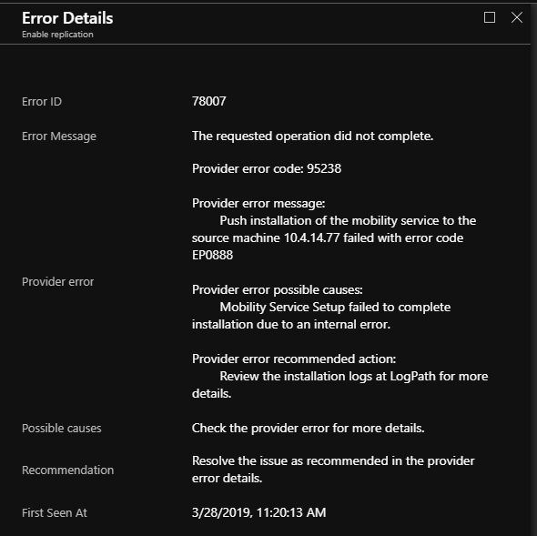
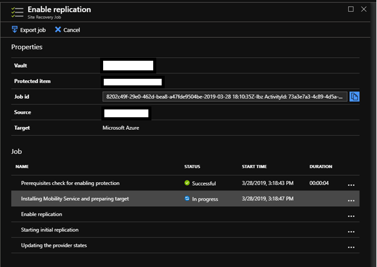

On this series, I want to explore all the situations that you might encounter when you are moving your workloads to the cloud, specially to Azure.

Today, while I was preparing for the next wave of migration of the workloads from on premise to Azure, I encounter the following error, while I was deploying the Azure Site Recovery (ASR) agent.

After research, I found on the Microsoft documentation the [Troubleshoot Mobility Service push installation issues](https://docs.microsoft.com/en-us/azure/site-recovery/vmware-azure-troubleshoot-push-install). Although the provider error code (in this case 95238) was not mention it. 

So, then I decide to troubleshoot myself. I remote desktop on the server, look at the logs, and I didn’t find anything that point me to the root cause of the failure on deploying the ASR agent. Then I decide to uninstall the agent, from the Program and Features and install manually to see what is happen.

After trying to install manually the ASR agent, I discover the server had a pending reboot. So, I reboot the server. After that I resume my attempt of installing manually the ASR agent. It worked without any error! Next step is to register the server with the Process Server. Done!

Then I went to Azure Portal to resume the job that failed, and guess what? It works just fine now!

Cheers,

**Marcos Nogueira**  
**_Azure MVP_**  
[azurecentric.com](http://azurecentric.com)  
Twitter: [@mdnoga](http://www.twitter.com/mdnoga)
