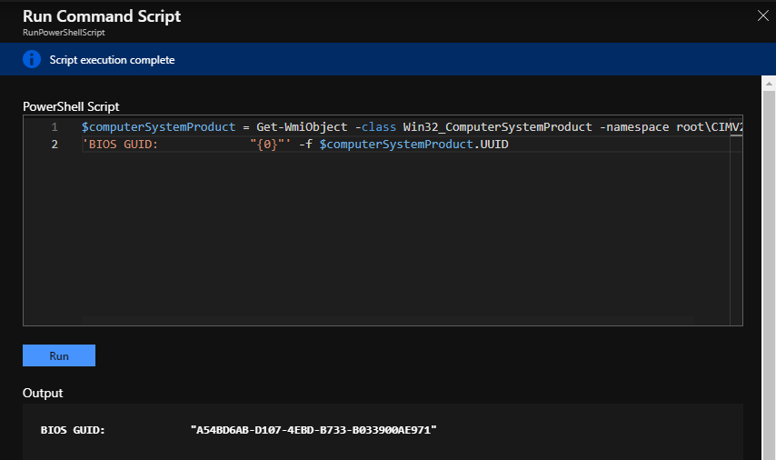

On this series, I want to explore all the situations that you might encounter when you are moving your workloads to the cloud, specially to Azure.

On this post I will cover how to get the Unique ID from an Azure VM. Why is that important? When you migrate your workload from on premise to Azure, in some occasions the license of your application is attached to the server. Usually the COTS application is using either the Unique ID of the VM or other method to guarantee that the license is not used on other places.

This Unique ID is an identifier that can be used in several scenarios whether the VM is running on Azure or even on premise. This Unique ID cannot be modified, it can only be query using WMI Objects. Azure VM Unique ID it will never change, even if you reboot, shutdown, stopped and start, being serviced or even if you restore. Although if you use the snapshot to create a new VM or instance, then the VM Unique ID will change. This feature is enabled natively since September 2014. If your workload doesn’t have a Unique ID, just restart you VM and you should get the Unique ID.

## Here is how you can query the Unique ID

For Windows VM use the following commands:

```powershell
_$computerSystemProduct = Get-WmiObject -class 'Win32_ComputerSystemProduct' -namespace 'root\CIMV2'
'BIOS GUID: "{0}"' -f $computerSystemProduct.UUID_
```



For Linux VM use the following commands:

```js
sudo dmidecode | grep UUID
```
Cheers,

**Marcos Nogueira**  
**_Azure MVP_**  
[azurecentric.com](http://azurecentric.com)  
Twitter: [@mdnoga](http://www.twitter.com/mdnoga)
