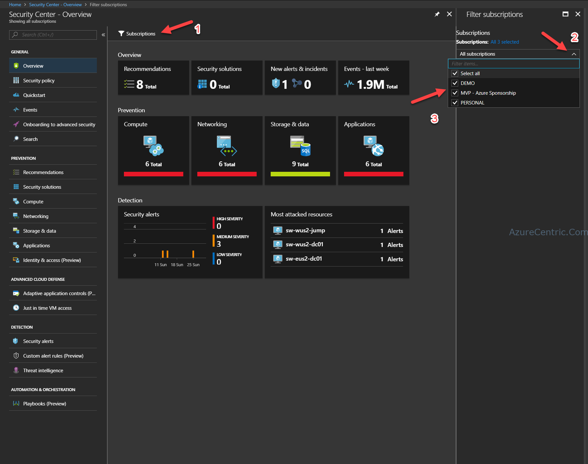

I was this week at one of my costumers, and one of the topics that came to the conversation was, how I can connect several Azure subscriptions within the same tenant to OMS?

One of the things that I like about Azure, is you have different ways to achieve the same goal. In this case, I found (once more), that Azure Monitor can really help on this one.

It is a simple process to implement:

1. Enter into the Azure Portal
2. Open Azure Security Center
3. Click on Subcriptions (Step 1)
4. Click on the Arrow down (Step 2)
5. Select all the subscriptions that you want to add to OMS (Step 3)
6. Add the Security and Audit on your OMS and point to the Security center.

Cheers,

**Marcos Nogueira**  
**_Azure MVP_**  
[azurecentric.com](http://azurecentric.com)  
Twitter: [@mdnoga](http://www.twitter.com/mdnoga)
