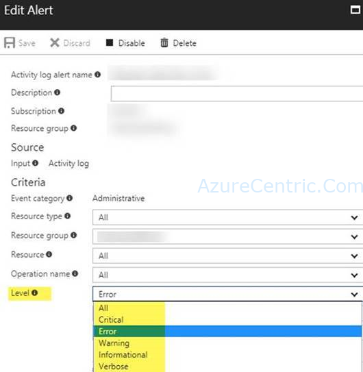

If you run into the situation, that you want to set multiple activity alerts into a resource that you want to monitor, but when you configure or want to edit the alert, you only see a single level of alert (picture below), you normally create another alert into the same resource.



That is a way to solve the issue, but you can create or have multiple level of alerts into the same resource. On the other hand, you could create a multiple level alert through JSON file and then apply the template to the resource you want to monitor.

The Activity Log Alert language is actually pretty powerful if you are willing to get your hands a little dirty and write the “condition” property in JSON yourself. For example, if you create an alert in the portal, and then look at the “Create Activity Log Alert” event in your Activity Log, you will see in the properties field there is the full JSON (unfortunately, delimited and in one field) of the alert that was created, and the “condition” property for an alert looks fairly similar to the JSON for ARM policy. It can contain:

1. Both allOf (ANDs) as well as anyOf (ORs)
2. Equals (on a property that has a single value) or containsAny (on a property that is an Array)
3. Either an explicit field name (eg “category”) or a JSON path with wildcards to any property that matches (eg. "**_properties.impactedServices[?(@.ServiceName == 'Virtual Machines')].ImpactedRegions[*].RegionName_**")

Here’s a complex example of what you could put in the condition in raw JSON that would work correctly:
```json
{
    "location": "global",
    "properties": {
        "scopes": [
            "/subscriptions/<SUBSCRIPTION_ID>"
        ],
        "description": "TEST",
        "condition": {
            "allOf": [
                {
                    "field": "category",
                    "equals": "ServiceHealth"
               },
                {
                    "field": "status",
                    "equals": "Active"
                },
                {
                    "field": "properties.impactedServices[?(@.ServiceName == 'Virtual Machines')].ImpactedRegions[*].RegionName",
                    "containsAny": [
                        "EastUS2",
                        "WestUS2"
                    ]
                }
            ],
            "anyOf": [
                {
                    "field": "level",
                    "equals": "Warning"
                },
                {
                    "field": "level",
                    "equals": "Error"
                }
            ]
        },
        "actions": {
            "actionGroups": [
                {
                    "actionGroupId": "/subscriptions/<SUBSCRIPTION_ID>/resourcegroups/default-activitylogalerts/providers/microsoft.insights/actiongroups/<GROUP_NAME>",
                    "webhookProperties": {}
                }
            ]
        },
        "enabled": true
    }
}
```
This translates to: “Activate the alert if there is an Active Service Health event on Virtual Machines in either East US 2 or West US 2, but only if the level is either Warning or Error.”

Cheers,

**Marcos Nogueira**  
**_Azure MVP_**  
[azurecentric.com](http://azurecentric.com)  
Twitter: [@mdnoga](http://www.twitter.com/mdnoga)
