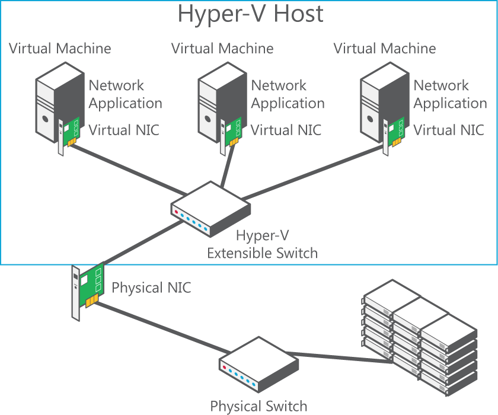
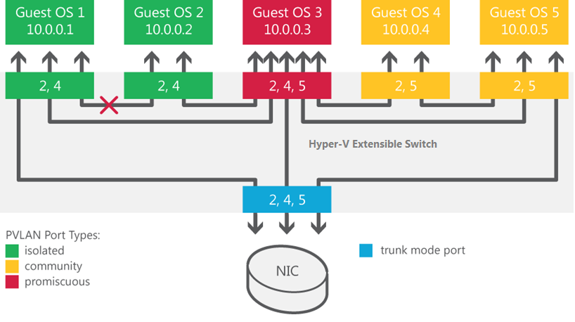

Virtualized data centers are becoming more popular and practical every day. IT organizations and hosting providers have begun offering infrastructure as a service (IaaS), which provides more flexible, virtualized infrastructures to customers—“server instances on‑demand.” Because of this trend, IT organizations and hosting providers must offer customers enhanced security and isolation from one another.

If you’re hosting two companies, you must help ensure that each company is provided its own privacy and security. Before Windows Server 2012, server virtualization provided isolation between virtual machines, but the network layer of the data center was still not fully isolated and implied layer-2 connectivity between different workloads that run over the same infrastructure.

For the hosting provider, isolation in the virtualized environment must be equal to isolation in the physical data center, to meet customer expectations and not be a barrier to cloud adoption.

Isolation is almost as important in an enterprise environment. Although all internal departments belong to the same organization, certain workloads and environments (such as finance and human resource systems) must still be isolated from each other. IT departments that offer private clouds and move to an IaaS operational mode must consider this requirement and provide a way to isolate such highly sensitive workloads.

Windows Server 2012 contains new security and isolation capabilities through the Hyper‑V Extensible Switch.

The Hyper‑V Extensible Switch is a layer‑2 virtual network switch that provides programmatically managed and extensible capabilities to connect virtual machines to the physical network with policy enforcement for security and isolation. The figure below shows a network with Hyper‑V Extensible Switch.

With Windows Server 2012, you can configure Hyper‑V servers to enforce network isolation among any set of arbitrary isolation groups, which are typically defined for individual customers or sets of workloads.

Multitenant security and isolation using the Hyper-V Extensible Switch is accomplished with private virtual LANs (PVLANs).

**Virtual machine isolation with PVLANs. **VLAN technology is traditionally used to subdivide a network and provide isolation for individual groups that share a single physical infrastructure. Windows Server 2012 introduces support for PVLANs, a technique used with VLANs that can be used to provide isolation between two virtual machines on the same VLAN.

When a virtual machine doesn’t need to communicate with other virtual machines, you can use PVLANs to isolate it from other virtual machines in your data center. By assigning each virtual machine in a PVLAN one primary VLAN ID and one or more secondary VLAN IDs, you can put the secondary PVLANs into one of three modes (as shown in the following figure). These PVLAN modes determine which other virtual machines on the PVLAN a virtual machine can talk to. If you want to isolate a virtual machine, put it in isolated mode.

The figure bellow shows how the three PVLAN modes can be used to isolate virtual machines that share a primary VLAN ID. In this example the primary VLAN ID is 2, and the two secondary VLAN IDs are 4 and 5.

You can put the secondary PVLANs into one of three modes:
  * **Isolated. **Isolated ports cannot exchange packets with each other at layer 2.
  * **Promiscuous. **Promiscuous ports can exchange packets with any other port on the same primary VLAN ID.
  * **Community. **Community ports on the same VLAN ID can exchange packets with each other at layer 2.

## **Other tools**

Other tools that provide enhanced multitenant security and isolation through the Hyper-V Extensible Switch are:

**Protection from Address Resolution Protocol/Neighbor Discovery (ARP/ND) poisoning (ARP spoofing)** The Hyper‑V Extensible Switch provides protection against a malicious virtual machine stealing IP addresses from other virtual machines through ARP spoofing (also known as ARP poisoning in IPv4). With this type of man-in-the-middle attack, a malicious virtual machine sends a fake ARP message, which associates its own MAC address to an IP address it doesn’t own. Unsuspecting virtual machines send the network traffic targeted to that IP address to the MAC address of the malicious virtual machine instead of the intended destination. For IPv6, Windows Server 2012 provides equivalent protection for ND spoofing.

**Dynamic Host Protocol (DHCP) guard protection** blocks virtual machines from providing services to other virtual machines. In a DHCP environment, a rogue DHCP server could intercept client DHCP requests and provide incorrect address information. The rogue DHCP server could cause traffic to be routed to a malicious intermediary that sniffs all traffic before forwarding it to the legitimate destination. To protect against this particular type of man-in-the-middle attack, the Hyper-V administrator can designate which virtual switch ports can have DHCP servers connected to them. DHCP server traffic from other virtual switch ports is automatically dropped. The Hyper-V Extensible Switch now protects against a rogue DHCP server attempting to provide IP addresses that would cause traffic to be rerouted.

### **Virtual port ACLs**

Virtual port access control lists (ACLs) provide the ability to block traffic by source and destination virtual machine. Port ACLs provide a mechanism for network isolation and metering network traffic for a virtual port on the Hyper‑V Extensible Switch. By using port ACLs , you can meter the IP or MAC addresses that can (or can’t) communicate with a virtual machine. For example, you can use port ACLs to enforce the isolation of a virtual machine by allowing it to talk only to the Internet or communicate only with a predefined set of addresses. By using the metering capability, you can measure network traffic going to or from a specific IP or MAC address, which allows you to report on traffic sent or received from the Internet or from network storage arrays.

You can configure multiple port ACLs for a virtual port. Each port ACL consists of a source or destination network address and a permit to deny or meter action. The metering capability also supplies information about the number of instances where traffic was attempted to or from a virtual machine from a restricted (“deny”) address.

**Trunk mode to virtual machines. **A VLAN makes a set of host machines or virtual machines appear to be on the same local LAN, independent of their actual physical locations. With the Hyper-V Extensible Switch trunk mode, traffic from multiple VLANs can now be directed to a single network adapter in a virtual machine that could previously receive traffic from only one VLAN. As a result, traffic from different VLANs is consolidated, and a virtual machine can listen in on multiple VLANs. This feature can help you shape network traffic and enhance multitenant security in your data center.

**Monitoring. **Many physical switches can monitor the traffic from specific ports flowing through specific virtual machines on the switch. The Hyper‑V Extensible Switch also provides this port mirroring. You can designate which virtual ports should be monitored and to which virtual port the monitored traffic should be delivered for further processing. For example, a security monitoring virtual machine can look for anomalous patterns in the traffic flowing through other specific virtual machines on the switch. In addition, you can diagnose network connectivity issues by monitoring traffic bound for a particular virtual switch port.

**Windows PowerShell/Windows Management Instrumentation (WMI)**. Windows Server 2012 now provides Windows PowerShell cmdlets for the Hyper‑V Extensible Switch that let you build command-line tools or automated scripts for setup, configuration, monitoring, and troubleshooting. These cmdlets can be run remotely. Windows PowerShell also enables third parties to build their own tools to manage the Hyper-V Extensible Switch.

## **Benefits**

Windows Server 2012 multitenant isolation keeps customer virtual machines isolated, even when they are stored on the same physical server. Windows Server 2012 provides better multitenant security for customers on a shared IaaS cloud through the new Hyper‑V Extensible Switch. Benefits of the Hyper‑V Extensible Switch for better multitenant security and isolation are:
  * **Security and isolation.** The Hyper‑V Extensible Switch provides better security and isolation for IaaS multitenancy with PVLAN support, protection against ARP poisoning and spoofing, protection against DHCP snooping, virtual port ACLs, and VLAN trunk mode support.
  * **Monitoring.** With port mirroring, you can run security and diagnostics applications in virtual machines that can monitor virtual machine network traffic. Port mirroring also supports live migration of extension configurations.
  * **Manageability.** You can now use Windows PowerShell and WMI support for command-line and automated scripting support plus full event logging.

Multitenant isolation in Windows Server 2012 addresses concerns that may have previously prevented organizations from deploying Hyper-V within their data centers. Two such concerns are (1) the additional management overhead of implementing VLANs on their Ethernet switching infrastructure to ensure isolation between their customers’ virtual infrastructures, and (2) the security risk of a multitenant virtualized environment. With Hyper-V in Windows Server 2012, you can now use port ACLs to isolate customers’ networks from one another and not be required to set up and maintain VLANs. Also, your security needs are provided by protection against ARP spoofing and DHCP snooping.

## **Requirements**

The requirements for using the Hyper-V Extensible Switch for multitenant security and isolation are:
  * Windows Server 2012
  * The Hyper-V server role

Cheers,

**Marcos Nogueira**
[azurecentric.com](http://azurecentric.com)
Twitter: [@mdnoga](http://www.twitter.com/mdnoga)
