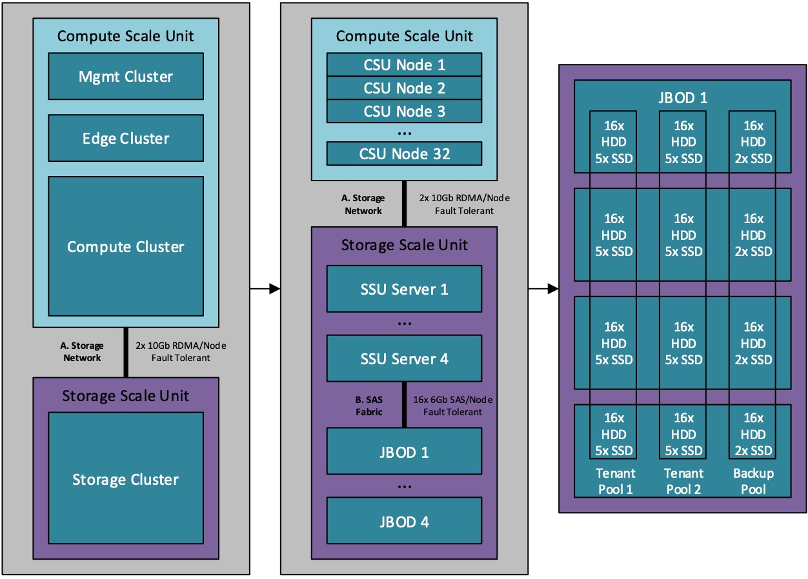

The Microsoft CPS Team (Cloud Platfform System aka Cloud-in-Box) recently authored a white paper that covers a variety of performance metrics. The white paper is broken down into three target scenarios:
  * **Scenario 1**. Boot storm: cold start of VMs.
  * **Scenario 2**. VM microbenchmarks: synthetic storage loads that are generated within VMs.
  * **Scenario 3**. VM database OLTP: simulated database online transaction processing (OLTP) using Microsoft SQL Server, run within the VMs.

The results of those scenarios are (at a very high level):
  * Boot storm: ~1800 Azure A1-sized VMs* cold started within 150 seconds at a median start time of 20 seconds/VM
  * VM microbenchmarks across 112 Azure A1-sized VMs:
    * 1.01 million 4KiB random read IOPS at an average latency of 0.90 milliseconds** (**ms), with 44% of SSU (storage scale unit) connectivity utilized
    * 321,000 mixed 4KiB (70:30) read/write IOPS at average latencies of 2.49ms read and 4.47ms write
    * VM SQL Server database OLTP across 84 Azure A4-sized VMs
      * sustained ~35,000 transactions/second (s)
      * 222,000 total IOPS (182,000 read and 40,000 write) at an average 1.5ms read and 9.0ms write latency

Feel free to check out the entirety of the white paper at the link below. Thanks!

[http://go.microsoft.com/fwlink/?LinkId=528407&WT.mc_id=Blog_WS_Announce_TTD](http://go.microsoft.com/fwlink/?LinkId=528407&WT.mc_id=Blog_WS_Announce_TTD)

Cheers,

**Marcos Nogueira**
**_MVP_**  
[azurecentric.com](http://azurecentric.com)
Twitter: [@mdnoga](http://www.twitter.com/mdnoga)
