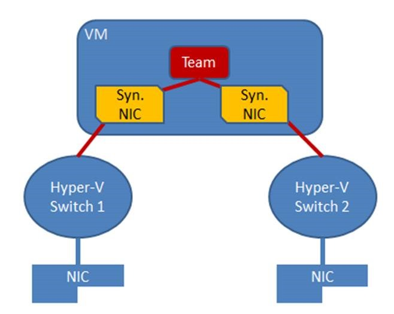
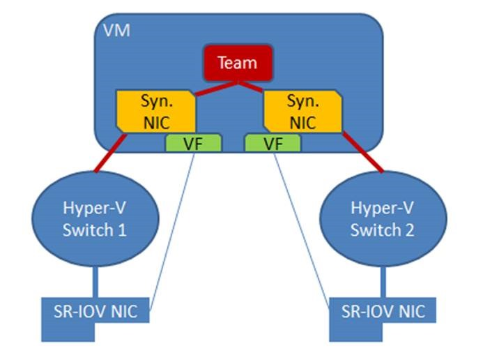
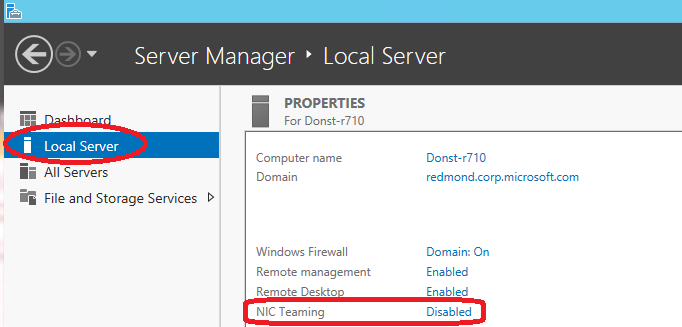

NIC Teaming in a VM only applies to VM-NICs connected to external switches. VM-NICs connected to internal or private switches will show as disconnected when they are in a team.  

  

NIC teaming in Windows Server 2012 may also be deployed in a VM. This allows a VM to have virtual NICs (synthetic NICs) connected to more than one Hyper-V switch and still maintain connectivity even if the physical NIC under one switch gets disconnected. This is particularly important when working with Single Root I/O Virtualization (SR-IOV) because SR-IOV traffic doesn’t go through the Hyper-V switch and thus cannot be protected by a team in or under the Hyper-V host. With the VM-teaming option an administrator can set up two Hyper-V switches, each connected to its own SR-IOV-capable NIC.  
    * Each VM can have a virtual function (VF) from one or both SR-IOV NICs and, in the event of a NIC disconnect, fail-over from the primary VF to the back-up adapter (VF).  
    * Alternately, the VM may have a VF from one NIC and a non-VF VM-NIC connected to another switch. If the NIC associated with the VF gets disconnected, the traffic can fail-over to the other switch without loss of connectivity.  

  

        **Note:** Because fail-over between NICs in a VM might result in traffic being sent with the MAC address of the other VM-NIC, each Hyper-V switch port associated with a VM that is using NIC Teaming must be set to allow teaming There are two ways to enable NIC Teaming in the VM:  

1. In the Hyper-V Manager, in the settings for the VM, select the VM’s NIC and the **Advanced Settings** item, then enable the checkbox for NIC Teaming in the VM.  

  

2. Run the following Windows PowerShell cmdlet in the host with elevated (Administrator) privileges.  
```powershell
Set-VMNetworkAdapter -VMName <VMname> -AllowTeaming On 
```
Teams created in a VM can only run in Switch Independent configuration, Address Hash distribution mode (or one of the specific address hashing modes). Only teams where each of the team members is connected to a different external Hyper-V switch are supported.  

Teaming in the VM does not affect Live Migration. The same rules exist for Live Migration whether or not NIC teaming is present in the VM.  

### No teaming of Hyper-V ports in the Host Partition

Hyper-V virtual NICs exposed in the host partition (vNICs) must not be placed in a team. Teaming of virtual NIC’s (vNICs) inside of the host partition is not supported in any configuration or combination. Attempts to team vNICs may result in a complete loss of communication in the event that network failures occur.  

## Feature compatibilities

NIC teaming is compatible with all networking capabilities in Windows Server 2012 with five exceptions: SR-IOV, RDMA, Native host Quality of Service, TCP Chimney, and 802.1X Authentication.  
    * For SR-IOV and RDMA, data is delivered directly to the NIC without passing it through the networking stack (in the host OS in the case of virtualization). Therefore, it is not possible for the team to look at or redirect the data to another path in the team.  
    * When QoS policies are set on a native or host system and those policies invoke minimum bandwidth limitations, the overall throughput through a NIC team will be less than it would be without the bandwidth policies in place.  
    * TCP Chimney is not supported with NIC teaming in Windows Server 2012 since TCP Chimney has the entire networking stack offloaded to the NIC.  
    * 802.1X Authentication should not be used with NIC Teaming and some switches will not permit configuration of both 802.1X Authentication and NIC Teaming on the same port.  
    
<table cellpadding="0" border="1" cellspacing="0" > <tbody > <tr >
<td width="218" valign="top" >

### **Feature**

</td>
<td width="510" valign="top" >

**Comments**

</td></tr> <tr >
<td width="218" valign="top" >

Datacenter bridging (DCB)

</td>
<td width="510" valign="top" >

Works independent of NIC Teaming so is supported if the team members support it.

</td></tr> <tr >
<td width="218" valign="top" >

IPsec Task Offload (IPsecTO)

</td>
<td width="510" valign="top" >

Supported if all team members support it.

</td></tr> <tr >
<td width="218" valign="top" >

Large Send Offload (LSO)

</td>
<td width="510" valign="top" >

Supported if all team members support it.

</td></tr> <tr >
<td width="218" valign="top" >

Receive side coalescing (RSC)

</td>
<td width="510" valign="top" >

Supported in hosts if any of the team members support it. Not supported through Hyper-V switches.

</td></tr> <tr >
<td width="218" valign="top" >

Receive side scaling (RSS)

</td>
<td width="510" valign="top" >

NIC teaming supports RSS in the host. The Windows Server 2012 TCP/IP stack programs the RSS information directly to the Team members. 

</td></tr> <tr >
<td width="218" valign="top" >

Receive-side Checksum offloads (IPv4, IPv6, TCP)

</td>
<td width="510" valign="top" >

Supported if any of the team members support it.

</td></tr> <tr >
<td width="218" valign="top" >

Remote Direct Memory Access (RDMA)

</td>
<td width="510" valign="top" >

Since RDMA data bypasses the Windows Server 2012 protocol stack, team members will not also support RDMA.

</td></tr> <tr >
<td width="218" valign="top" >

Single root I/O virtualization (SR-IOV)

</td>
<td width="510" valign="top" >

Since SR-IOV data bypasses the host OS stack, NICs exposing the SR-IOV feature will no longer expose the feature while a member of a team. Teams can be created in VMs to team SR-IOV virtual functions (VFs).

</td></tr> <tr >
<td width="218" valign="top" >

TCP Chimney Offload 

</td>
<td width="510" valign="top" >

Not supported through a Windows Server 2012 team.

</td></tr> <tr >
<td width="218" valign="top" >

Transmit-side Checksum offloads (IPv4, IPv6, TCP)

</td>
<td width="510" valign="top" >

Supported if all team members support it.

</td></tr> <tr >
<td width="218" valign="top" >

Virtual Machine Queues (VMQ)

</td>
<td width="510" valign="top" >

Supported when teaming is installed under the Hyper-V switch.

</td></tr> <tr >
<td width="218" valign="top" >

QoS in host/native OSs

</td>
<td width="510" valign="top" >

Use of minimum bandwidth policies will degrade throughput through a team.

</td></tr> <tr >
<td width="218" valign="top" >

Virtual Machine QoS (VM-QoS)

</td>
<td width="510" valign="top" >

VM-QoS is affected by the load distribution algorithm used by NIC Teaming. For best results use HyperVPorts load distribution mode.

</td></tr> <tr >
<td width="218" valign="top" >

802.1X authentication

</td>
<td width="510" valign="top" >

Not compatible with many switches. Should not be used with NIC Teaming.

</td></tr></tbody></table>

## NIC Teaming and Virtual Machine Queues (VMQs)

VMQ and NIC Teaming work well together; VMQ should be enabled anytime Hyper-V is enabled. Depending on the switch configuration mode and the load distribution algorithm, NIC teaming will either present VMQ capabilities to the Hyper-V switch that show the number of queues available to be the smallest number of queues supported by any adapter in the team (Min-queues mode) or the total number of queues available across all team members (Sum-of-Queues mode). Specifically,  
    * if the team is in Switch-Independent teaming mode and the Load Distribution is set to Hyper-V Port mode, then the number of queues reported is the sum of all the queues available from the team members (**Sum-of-Queues** mode);  
    * Otherwise the number of queues reported is the smallest number of queues supported by any member of the team (**Min-Queues** mode).  

Here’s why.  
    * When the team is in switch independent/Hyper-V Port mode the inbound traffic for a VM will always arrive on the same team member. The host can predict which member will receive the traffic for a particular VM so NIC Teaming can be more thoughtful about which VMQ Queues to allocate on a particular team member. NIC Teaming, working with the Hyper-V switch, will set the VMQ for a VM on exactly one team member and know that inbound traffic will hit that queue.  
    * When the team is in any switch dependent mode (static teaming or LACP teaming), the switch that the team is connected to controls the inbound traffic distribution. The host’s NIC Teaming software can’t predict which team member will get the inbound traffic for a VM and it may be that the switch distributes the traffic for a VM across all team members. As a result the NIC Teaming software, working with the Hyper-V switch, programs a queue for the VM on every team member, not just one team member.  
    * When the team is in switch-independent mode and is using an address hash load distribution algorithm, the inbound traffic will always come in on one NIC (the primary team member) – all of it on just one team member. Since other team members aren’t dealing with inbound traffic they get programmed with the same queues as the primary member so that if the primary member fails any other team member can be used to pick up the inbound traffic and the queues are already in place.  

There are a few settings that will help the system perform even better.  

Each NIC has, in its advanced properties, values for *RssBaseProcNumber and *MaxRssProcessors.  
    * Ideally each NIC should have the *RssBaseProcNumber set to an even number greater than or equal to two (2). This is because the first physical processor, Core 0 (logical processors 0 and 1), typically does most of the system processing so the network processing should be steered away from this physical processor. (Some machine architectures don’t have two logical processors per physical processor so for such machines the base processor should be greater than or equal to 1. If in doubt assume your host is using a 2 logical processor per physical processor architecture.)  
    * If the team is in **Sum-of-Queues** mode the team members’ processors should be, to the extent possible, non-overlapping. For example, in a 4-core host (8 logical processors) with a team of 2 10Gbps NICs, you could set the first one to use base processor of 2 and to use 4 cores; the second would be set to use base processor 6 and use 2 cores.  
    * If the team is in **Min-Queues** mode the processor sets used by the team members _must_ be identical.  

Cheers,

**Marcos Nogueira**
[azurecentric.com](http://azurecentric.com)
Twitter: [@mdnoga](http://www.twitter.com/mdnoga)
