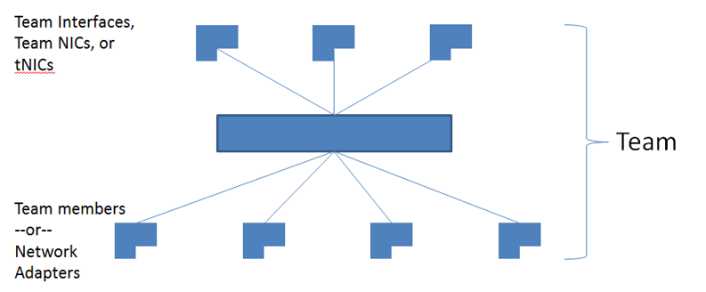

NIC teaming, also known as Load Balancing/Failover (LBFO), allows multiple network adapters to be placed into a team for the purposes of
  * bandwidth aggregation, and/or
  * traffic failover to maintain connectivity in the event of a network component failure.

This feature has long been available from NIC vendors but until now NIC teaming has not been included with Windows Server.

The following sections address:
  * NIC teaming architecture
  * Bandwidth aggregation (also known as load balancing) mechanisms
  * Failover algorithms
  * NIC feature support – stateless task offloads and more complex NIC functionality
  * A detailed walkthrough how to use the NIC Teaming management tools

NIC teaming is available in Windows Server 2012 in all editions, both Server Core and Full Server versions. NIC teaming is not available in Windows 8, however the NIC teaming User Interface and the NIC Teaming Windows PowerShell Cmdlets can both be run on Windows 8 so that a Windows 8 PC can be used to manage teaming on one or more Windows Server 2012 hosts.

## Existing architectures for NIC teaming

Today virtually all NIC teaming solutions on the market have an architecture similar to that shown in Figure 1.

One or more physical NICs are connected into the NIC teaming solution common core, which then presents one or more virtual adapters (_team NICs_ [tNICs] or _team interfaces_) to the operating system. There are a variety of algorithms that distribute outbound traffic between the NICs.

The only reason to create multiple team interfaces is to logically divide inbound traffic by virtual LAN (VLAN). This allows a host to be connected to different VLANs at the same time. When a team is connected to a Hyper-V switch all VLAN segregation should be done in the Hyper-V switch instead of in the NIC Teaming software.

## **Configurations for NIC Teaming**

There are two basic configurations for NIC Teaming.

**Switch-independent teaming**. This configuration does not require the switch to participate in the teaming. Since in switch-independent mode the switch does not know that the network adapter is part of a team in the host, the adapters may be connected to different switches. Switch independent modes of operation do not require that the team members connect to different switches; they merely make it possible.
  * **Active/Standby Teaming:** Some administrators prefer not to take advantage of the bandwidth aggregation capabilities of NIC Teaming. These administrators choose to use one NIC for traffic (active) and one NIC to be held in reserve (standby) to come into action if the active NIC fails. To use this mode set the team in Switch-independent teaming. Active/Standby is not required to get fault tolerance; fault tolerance is always present anytime there are at least two network adapters in a team.
  * **Switch-dependent teaming:** This configuration that requires the switch to participate in the teaming. Switch dependent teaming requires all the members of the team to be connected to the same physical switch.

There are two modes of operation for switch-dependent teaming:
  * **Generic or static teaming (IEEE 802.3ad).** This mode requires configuration on both the switch and the host to identify which links form the team. Since this is a statically configured solution there is no additional protocol to assist the switch and the host to identify incorrectly plugged cables or other errors that could cause the team to fail to perform. This mode is typically supported by server-class switches.
  * **Dynamic teaming (IEEE 802.1ax, LACP).** This mode is also commonly referred to as IEEE 802.3ad as it was developed in the IEEE 802.3ad committee before being published as IEEE 802.1ax. IEEE 802.1ax works by using the Link Aggregation Control Protocol (LACP) to dynamically identify links that are connected between the host and a given switch. This enables the automatic creation of a team and, in theory but rarely in practice, the expansion and reduction of a team simply by the transmission or receipt of LACP packets from the peer entity. Typical server-class switches support IEEE 802.1ax but most require the network operator to administratively enable LACP on the port.

Both of these modes allow both inbound and outbound traffic to approach the practical limits of the aggregated bandwidth because the pool of team members is seen as a single pipe.

## **Algorithms for traffic distribution**

Outbound traffic can be distributed among the available links in many ways. One rule that guides any distribution algorithm is to try to keep all packets associated with a single flow (TCP-stream) on a single network adapter. This rule minimizes performance degradation caused by reassembling out-of-order TCP segments.

NIC teaming in Windows Server 2012 supports the following traffic distribution algorithms:
  * **Hyper-V switch port:** Since VMs have independent MAC addresses, the VM’s MAC address or the port it’s connected to on the Hyper-V switch can be the basis for dividing traffic. There is an advantage in using this scheme in virtualization. Because the adjacent switch always sees a particular MAC address on one and only one connected port, the switch will distribute the ingress load (the traffic from the switch to the host) on multiple links based on the destination MAC (VM MAC) address. This is particularly useful when Virtual Machine Queues (VMQs) are used as a queue can be placed on the specific NIC where the traffic is expected to arrive. However, if the host has only a few VMs, this mode may not be granular enough to get a well-balanced distribution. This mode will also always limit a single VM (i.e., the traffic from a single switch port) to the bandwidth available on a single interface. Windows Server 2012 uses the Hyper-V Switch Port as the identifier rather than the source MAC address as, in some instances, a VM may be using more than one MAC address on a switch port.
  * **Address Hashing.** This algorithm creates a hash based on address components of the packet and then assigns packets that have that hash value to one of the available adapters. Usually this mechanism alone is sufficient to create a reasonable balance across the available adapters.

The components that can be specified as inputs to the hashing function include the following:
  * Source and destination MAC addresses
  * Source and destination IP addresses
  * Source and destination TCP ports and source and destination IP addresses

The TCP ports hash creates the most granular distribution of traffic streams resulting in smaller streams that can be independently moved between members. However, it cannot be used for traffic that is not TCP or UDP-based or where the TCP and UDP ports are hidden from the stack, such as IPsec-protected traffic. In these cases, the hash automatically falls back to the IP address hash or, if the traffic is not IP traffic, to the MAC address hash.

## **Interactions between Configurations and Load distribution algorithms**

### **Switch Independent configuration / Address Hash distribution**

This configuration will send packets using all active team members distributing the load through the use of the selected level of address hashing (defaults to using TCP ports and IP addresses to seed the hash function).

Because a given IP address can only be associated with a single MAC address for routing purposes, this mode receives inbound traffic on only one team member (the primary member). This means that the inbound traffic cannot exceed the bandwidth of one team member no matter how much is getting sent.

This mode is best used for:
  1. Native mode teaming where switch diversity is a concern;
  2. Active/Standby mode teams; and
  3. Teaming in a VM.
  It is also good for:
  4. Servers running workloads that are heavy outbound, light inbound workloads (e.g., IIS).

### **Switch Independent configuration / Hyper-V Port distribution**

This configuration will send packets using all active team members distributing the load based on the Hyper-V switch port number. Each Hyper-V port will be bandwidth limited to not more than one team member’s bandwidth because the port is affinitized to exactly one team member at any point in time.

Because each VM (Hyper-V port) is associated with a single team member, this mode receives inbound traffic for the VM on the same team member the VM’s outbound traffic uses. This also allows maximum use of Virtual Machine Queues (VMQs) for better performance over all.

This mode is best used for teaming under the Hyper-V switch when
  1. The number of VMs well-exceeds the number of team members; and
  2. A restriction of a VM to not greater than one NIC’s bandwidth is acceptable

### **Switch Dependent configuration / Address Hash distribution**

This configuration will send packets using all active team members distributing the load through the use of the selected level of address hashing (defaults to 4-tuple hash).

Like in all switch dependent configurations, the switch determines how to distribute the inbound traffic among the team members. The switch is expected to do a reasonable job of distributing the traffic across the team members but it has complete independence to determine how it does so.

Best used for:
  1. Native teaming for maximum performance and switch diversity is not required; or
  2. Teaming under the Hyper-V switch when an individual VM needs to be able to transmit at rates in excess of what one team member can deliver.

### **Switch Dependent configuration / **Hyper-V Port distribution** **

This configuration will send packets using all active team members distributing the load based on the Hyper-V switch port number. Each Hyper-V port will be bandwidth limited to not more than one team member’s bandwidth because the port is “affinitized” to exactly one team member at any point in time.

Like in all switch dependent configurations, the switch determines how to distribute the inbound traffic among the team members. The switch is expected to do a reasonable job of distributing the traffic across the team members but it has complete independence to determine how it does so.

Best used when:
  1. Hyper-V teaming when VMs on the switch well-exceed the number of team members **and**
  2. When policy calls for switch dependent (e.g., LACP) teams **and**
  3. When the restriction of a VM to not greater than one NIC’s bandwidth is acceptable.

Cheers,

**Marcos Nogueira**
[azurecentric.com](http://azurecentric.com)
Twitter: [@mdnoga](http://www.twitter.com/mdnoga)
