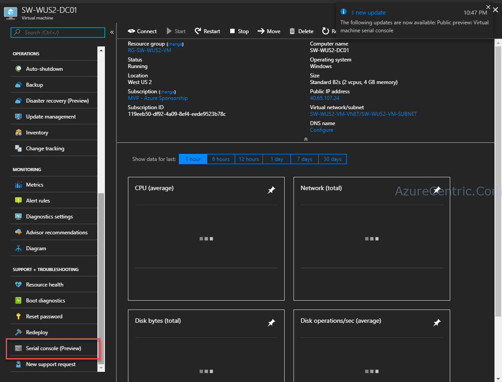
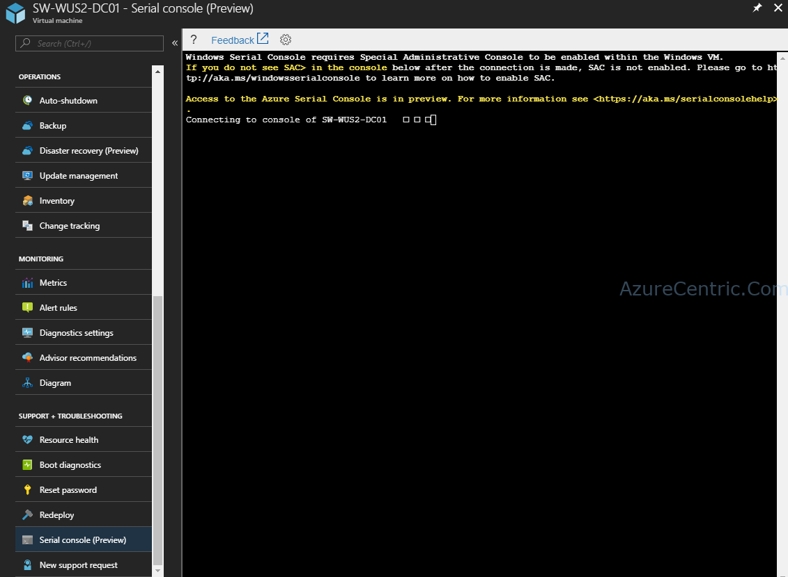
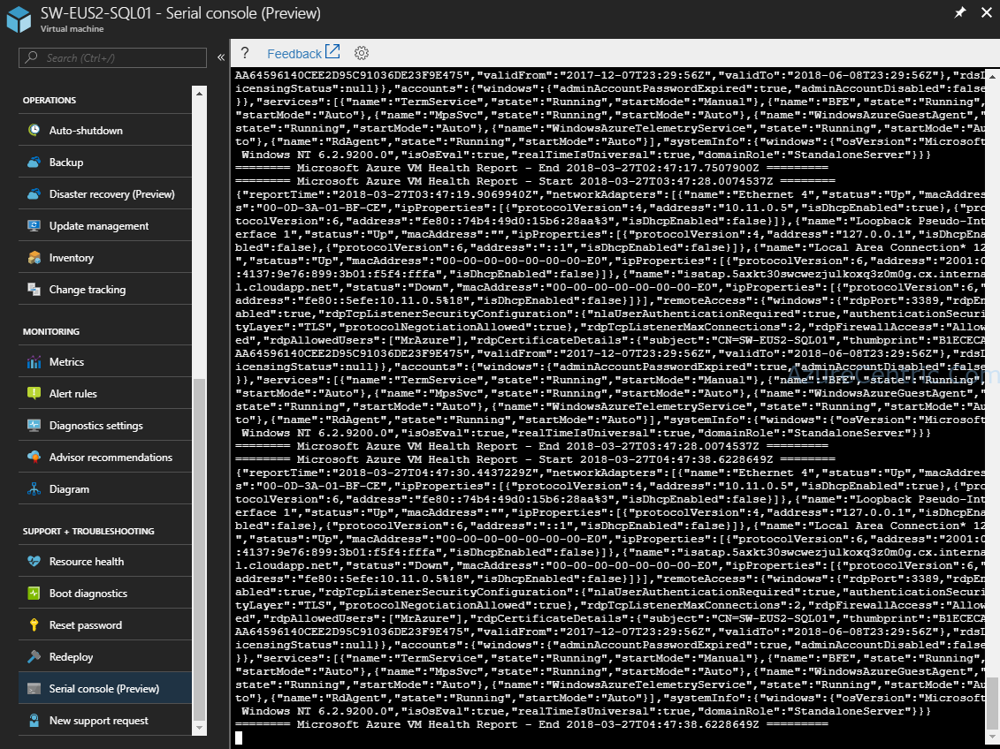
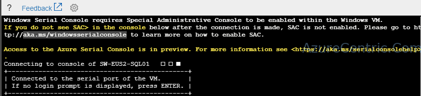
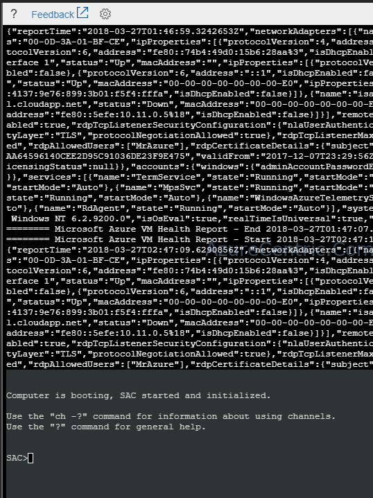
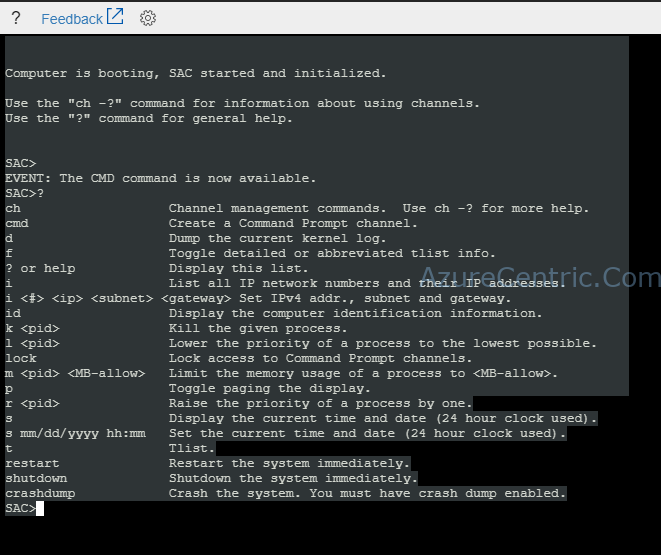

Finally come the day that Microsoft was able to announce this feature. Accessing the serial console on an Azure VM is a huge step forward. But why is so important? It’s huge! Sometimes when our friend Mr Murphy comes and makes everything goes south, you are in a certain way limited on the diagnostic tools that you have, to troubleshoot the cause of that machine is not booting. Have access to the boot of the server (Linux or Windows) is crucial at this time. Serial Console access will end those day of redeploy a VM using the same disk, when this option is viable, off course. You can see the announcement [here](https://azure.microsoft.com/en-us/blog/virtual-machine-serial-console-access/?t=1&cn=ZmxleGlibGVfcmVjc18y&refsrc=email&iid=e9515bdfa7fc4e82a5d90c176e6fbb4e&fl=4&uid=874678217809973248&nid=244+276893704).

But let’s dive into the Accessing the Serial Console. On each VM that you have running on Azure, under the **SUPPORT + TROUBLESHOOTING**, you will find the **_Serial console (preview)_**.



When you click on that, automatically start to connect to the Serial Console of that VM.



After a few seconds, finishes the connection. And show me this screen. But I can’t do anything.



If you scroll up, then some light at the end of the tunnel. OK, I need to enable the SAC (Special Administrative Console) on the server.



To access the Serial Console on the server you need the enable it. To enable, just follow the steps below:

1. Connect to your VM through RDP (in this case a Windows VM)
2. Open the cmd with elevated (administrative privileges)
3. From the cmd prompt run the following commands
```js
bcdedit /ems {current} on bcdedit /emssettings EMSPORT:1 EMSBAUDRATE:115200
```
4. Reboot the VM



And then, you have access to the serial console of your server.



Cheers,

**Marcos Nogueira**  
**_Azure MVP_**  
[azurecentric.com](http://azurecentric.com)  
Twitter: [@mdnoga](http://www.twitter.com/mdnoga)
