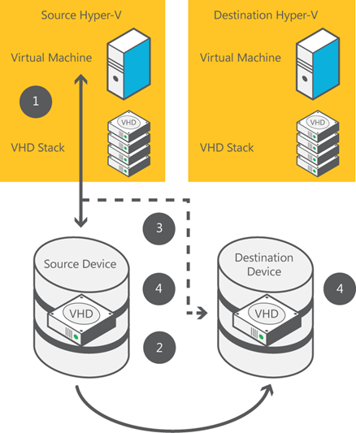

When you perform a live migration of a virtual machine between two computers that do not share an infrastructure, Hyper‑V first performs a partial migration of the virtual machine’s storage, as shown in the **figure below**.

Hyper‑V performs the following steps:	
  1. Throughout most of the move operation, disk reads and writes go to the source virtual hard disk.
  2. While reads and writes occur on the source virtual hard disk, the disk contents are copied over the network to the new destination virtual hard disk.
  3. After the initial disk copy is complete, disk writes are mirrored to both the source and destination virtual hard disks while outstanding disk changes are replicated.
  4. After the source and destination virtual hard disks are synchronized, the virtual machine live migration is initiated, following the same process that was used for live migration with shared storage.
  5. After the live migration is complete and the virtual machine is successfully running on the destination server, the files on the source server are deleted.

After the virtual machine’s storage is migrated, the virtual machine migrates while it continues to run and provide network services.

## **Benefits**

Live migration, which was introduced with Windows Server 2008 R2, was a valuable improvement for cloud management, giving organizations the ability to move virtual machines without shutting them down. As an organization’s customer base grows, managing the cloud environment becomes more challenging because to use resources effectively, administrators must move virtual machines within a cluster and between clusters more frequently.

With the Windows Server 2012 Hyper‑V live migration improvements, organizations can now not only perform live migrations, but they can also quickly move many virtual machines between clusters and now even to servers that do not share storage, all without downtime. These improvements significantly increase the flexibility of virtual machine placement by providing truly dynamic mobility of virtual machines across a data center. These improvements also increase administrator efficiency and eliminate the user downtime that was previously incurred for migrations across cluster boundaries. In addition to saving time because migration speed is faster, you also save time because you can perform multiple simultaneous live migrations.

## **Requirements**

**All live migrations** require the following:
  * Windows Server 2012.
  * Two or more Hyper‑V hosts:
    * Servers that support hardware virtualization.
    * Servers that use processors from the same manufacturer (for example, all AMD or all Intel).
  * Hyper‑V hosts that are part of the same Active Directory domain.
  * Virtual machines that are configured to use virtual hard disks or Virtual Fiber Channel disks (no direct-attached storage).
  * A private network for live migration network traffic.

**Live migration in a cluster** requires:
  * The Windows Failover Cluster Manager feature enabled and configured.
  * Cluster Shared Volume (CSV) storage in the cluster enabled.

**Live migration by using shared storage** requires the following:
  * All files on a virtual machine (such as virtual hard disks, snapshots, and configuration) stored on a Server Message Block 2.2 (SMB2) share.
  * Permissions on the SMB2 share configured to grant access to the computer accounts of all Hyper‑V hosts.

**Live migration with no shared infrastructure** has no additional requirements.

Cheers,

**Marcos Nogueira**
[azurecentric.com](http://azurecentric.com)
Twitter: [@mdnoga](http://www.twitter.com/mdnoga)
