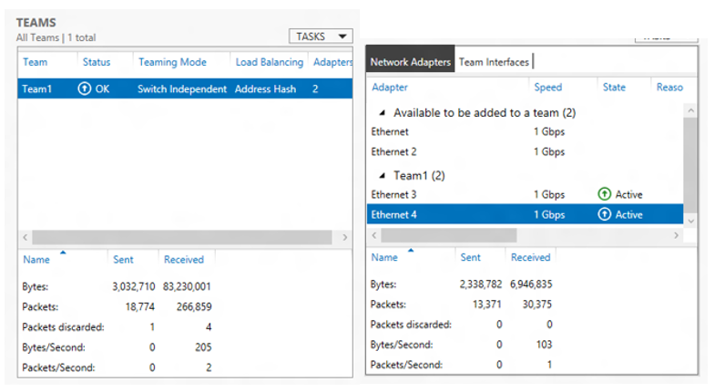
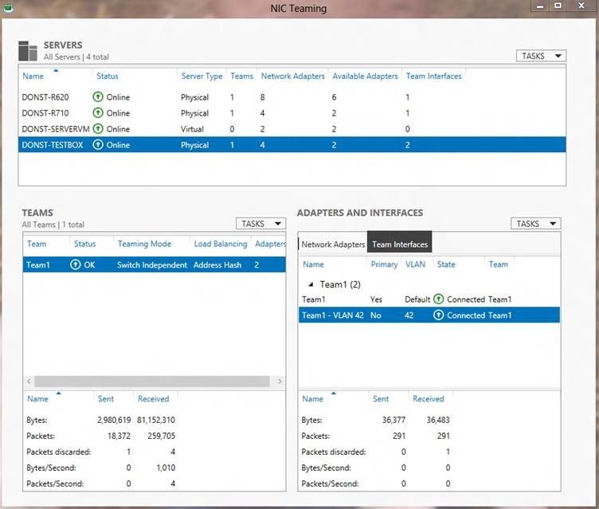
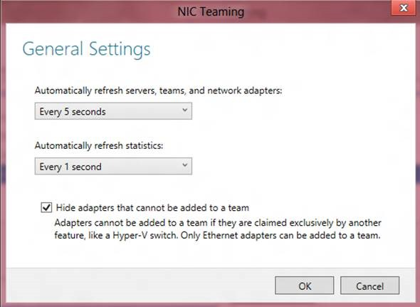

If the UI window is sufficiently tall a statistics tile appears at the bottom of the Team tile and the Adapters and Interfaces tile. These statistics windows reflect the traffic of the selected team and selected team member. If you don’t see the statistics try making the UI window a little taller.

  

## Viewing statistics for a team interface

If the Team Interfaces tab is selected in the Adapters and Interfaces tile the statistics at the bottom of the Adapters and Interfaces tile will be those of the selected team interface.  

  

## Setting frequency of Statistics updates

The frequency of statistics updates and other updates can be set by selection Settings in the Servers tile Tasks menu. Selecting this item brings up the General Settings dialog box.  

  

The two drop-down lists in this dialog box allow the user to change how often the UI is refreshed. The settings apply equally to all servers in the servers list.  

This menu also allows the administrator to decide whether or not adapters that are not able to be part of a team should be shown in the UI. By default these non-teamable adapters are not shown.  

Cheers,

**Marcos Nogueira**
[azurecentric.com](http://azurecentric.com)
Twitter: [@mdnoga](http://www.twitter.com/mdnoga)
