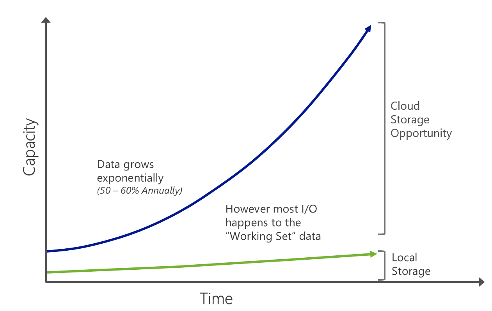
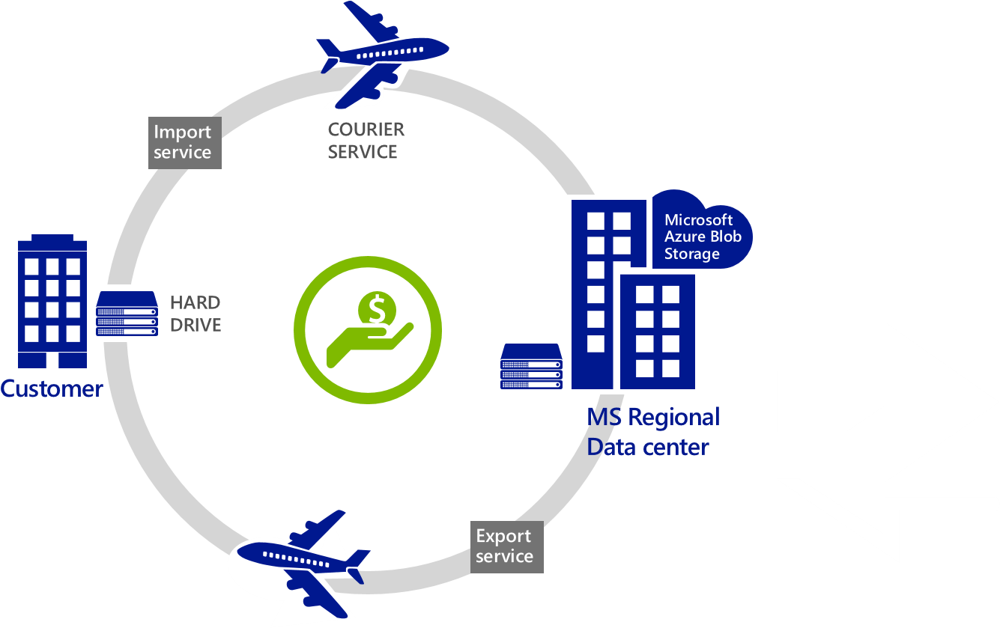

Let’s first understand why Cloud makes for a great storage option?

A typical organization increases their data storage by 50-60% every year (source: IDC). But only a small portion of the data is frequently accessed or used. So, using purely on-premises storage like SAN/NAS solutions for that data is expensive. Forrester’s study placed a cost of about USD$95 per GB of data per year for an on-premises SAN solution which is 4X the cost of putting a GB in the Cloud.

Of course, not all data can be put in the Cloud for performance or compliance reasons but where you can, using Azure for all backup and archived data, as well as less frequently accessed primary data makes a great business case.

Let us now understand the Azure storage system and some of its salient features.

First we have to treat Azure as a giant “hard drive”. Why do I call it a giant? Azure Storage has **over 10 trillion objects**, processes an average of **270,000 requests per second**, and reaches peaks of **880k requests per second**! Did you get the point?

Azure Blob storage is actually the top most rated by Nasuni Cloud storage report. This ranking is based on a number of factors like read/write speeds, availability and performance metrics.

Microsoft make 3 copies of data for durability and availability. So, if a rack or server goes down, your data is still available and accessible. Microsoft provide an 99.9% SLA for storage.

Azure Storage system is the underpinning to everything in Azure that requires storage. The Azure storage system provides a solid robust data platform for different services that make use of it – Blobs, Tables and Drives.

Use Blob service for storing large amounts of **unstructured data **that can be accessed from anywhere in the world via HTTP or HTTPS. A single blob can be hundreds of gigabytes in size, and a single storage account can contain up to 100TB of blobs. Common uses of Blob storage include: Serving images or documents directly to a browser, storing files for distributed access, Streaming video and audio, performing secure backup and disaster recovery, Storing data for analysis by an on-premises or Azure-hosted service

Tables is a **NoSQL datastore **which is ideal for storing structured, non-relational data. Common uses of the Table service include: Storing TBs of structured data capable of serving web scale applications, or storing datasets that don’t require a full-fledged relational DB.

Drives are what are attached to VMs. They automatically provide get the same durability and availability. **This differentiates Microsoft from other competitive offerings (like AWS) that have less reliable and durable storage systems for their VM instances**.

Typically, large data sets take a very long time to upload or download over a network; For example, with a network 10 TB of data will take at least one month to upload over a T3 line.  With Azure import/export, this problem is eliminated.  Import/Export enables you to move your large dataset to the Azure cloud more efficiently than over your network.

Similarly, you can use this service to export data that you need to recover: Microsoft download it at the Microsoft Regional Datacenters, and ship it back to you.

Per a recent survey, (source: Forrester) 49% of those surveyed plans to move their data or already have moved their data storage to the cloud, citing both cost reduction and flexibility as reasons to move storage into the cloud. 80% of IT decision makers in a recent study cited that encryption in transit was of critical or high importance. (source: Forrester)

A Forrester study also estimated a cost of about USD$95 per GB of data per year for an on-premises SAN solution which is 4X the cost of putting a GB of data into Azure.

Cheers,

**Marcos Nogueira**
[azurecentric.com](http://azurecentric.com)
Twitter: [@mdnoga](http://www.twitter.com/mdnoga)
