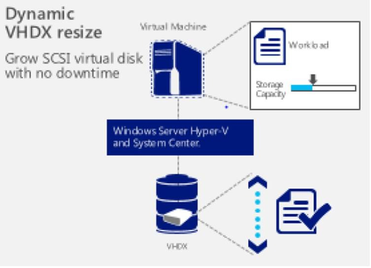

The notion of infrastructure provisioning is about enabling enterprises and service providers to provision physical, virtual, and cloud infrastructure that meets key requirements such as workload scale and performance, multi-tenancy, and chargeback.

## Enterprise-class performance

When virtualizing top-tier applications, you need a virtualization platform and virtualization management solution that can provide the necessary scale and performance to meet your business requirements. Many virtualization efforts do not realize their full potential; in many instances, it is due to the lack of adequate datacenter management which can lead to uncontrolled VM sprawl. Simultaneously, the datacenter management solution has to be flexible enough so it builds on your existing infrastructure investments. For example, applications might be deployed on physical servers and consuming SAN-based storage. Also, most customers have to support a diverse datacenter infrastructure environment to deliver on the requirements of their application counterparts.

System Center 2012 R2 delivers best-in-class management for Windows Server environments by supporting the scale and performance delivered by Windows Server 2012 R2. In this context, customers should note that Microsoft is slated to deliver System Center 2012 R2 simultaneously with Windows Server 2012 R2 so that you can plan your infrastructure deployments with the confidence and knowledge that System Center will enable them to take maximum advantage of native platform capabilities. The Virtual Machine Manager (VMM) component of System Center 2012 R2 plays a critical role in enabling virtualization-management scale – for instance, a single VMM server can support up to 1,000 hosts and up to 25,000 virtual machines. As another example, VMM enables Dynamic Memory changes as well as snapshots of running VMs without downtime.

To enable maximum flexibility and operational efficiency for customers, VMM enables storage management across a variety of storage approaches across file and block storage. For who have invested in block-based storage like SAN, VMM supports VM connectivity to SANs through virtual fibre channel switches. This enables IT staff to virtualize the most demanding workloads and connect them directly to the highest tier storage platforms.

Microsoft developed System Center to provide robust support for heterogeneous datacenter management – Dynamic Memory support for Linux VMs being an example. In fact, approximately 25% of System Center instances deployed today also manage Linux operating environments.

## Simplified provisioning and migration

As a next step, organizations should consider industry-standard server technologies as an alternative to specialty hardware technologies for big budget infrastructure spending like storage and disaster recovery. These technologies have advanced to the point where they offer many of the capabilities and the performance of specialty hardware, for a fraction of the price. To ensure that scarce IT staff can focus on strategic IT projects versus keeping the train running, they should continue to invest in automation technologies to ensure predictable deployments while mitigating chances of human error.

With Windows Server 2012, Microsoft delivered File and Storage Services (which included Storage Spaces), which is predicated on the use of industry-standard storage that’s completely managed by server software. These storage technologies are designed to provide availability, resiliency, and performance that would normally be expected from high-end hardware. With System Center 2012 R2, VMM supports at-scale management of these storage technologies – for instance, bare-metal provisioning of scale-out Windows File Server clusters, discovery of physical disks, and creation of virtualized storage pools.

To reduce time, effort and downtime required to upgrade from Windows Server 2012, Windows Server 2012 R2 is slated to offer the ability to automatically upgrade Hyper-V clusters (based on Windows Server 2012) to Windows Server 2012 R2 using System Center. The VMM component has a cross-version migration capability that enables Hyper-V Live Migration of workloads from Windows Server 2012 hosts to Windows Server 2012 R2 hosts. Microsoft is also enabling faster deployments of System Center by providing service templates and runbooks for multiple components such as Service Manager, Data Protection Manager, and Operations Manager.

SCVMM also simplifies cross-datacenter disaster recovery of VM-based infrastructure services by providing the private cloud abstraction layer in the source and destination datacenters. This is enabled by System Center working in conjunction with Hyper-V Replica (for VM replication) and Windows Azure Hyper-V Recovery Manager (for automated recovery orchestration). Without this capability, we would be looking at alternatives like expensive SAN-based replication.

Finally, the Orchestrator component of System Center 2012 R2 continues to enable general purpose datacenter automation thereby driving consistency and predictability in provisioning processes like server deployment, patching, and upgrades.

## Multitenant cloud infrastructure

As cloud computing adoption increases, large enterprises and hosters are looking to take their datacenter infrastructure to the next level of scale and efficiency and scale, with requirements such as multi-tenancy, bring-your-own-IP flexibility, chargeback, and infrastructure standardization. Many enterprises are also exploring showback and chargeback solutions to incentivize the right infrastructure consumption behaviours by their internal customers.

With System Center 2012, Microsoft enabled multi-hypervisor private clouds for enterprise IT to deliver infrastructure as a pool of automated resources and carve out datacenter capacity for use by their LOB counterparts. Building on that, System Center 2012 SP1 delivered support for multitenant environments (for service providers and large enterprises) through support for virtual networks and the ability to aggregate multiple instances of System Center infrastructure with the Service Provider Foundation (SPF) API.

Building on this strong foundation, System Center 2012 R2 strengthens Microsoft’s software-defined networking solution by enabling provisioning of multitenant edge gateways to bridge physical and virtual datacenters – this will enable flexible workload mobility in hybrid cloud computing models. System Center 2012 R2 enables chargeback for multitenant environments with granular infrastructure metering combined with the ability to do analytics on business and operational metrics. Customers can also take advantage of Cloud Cruiser (ISV, who is part of the Microsoft partner alliance) cost analytics for a more fully featured chargeback solution.

## Extend System Center to provision Windows Azure infrastructure

System Center 2012 R2 provides a unified tool to provision and manage virtual machines into on-premises and Windows Azure environments, including easy workload portability without a need for format conversion. The App Controller component of System Center 2012 R2 enables migration of on-premises Hyper-V VMs into Windows Azure Virtual Machines. Once in Windows Azure, the Virtual Machine can be managed (including operations like start, stop) through the App Controller user interface.

The Orchestrator component of System Center 2012 R2 provides a Windows Azure Integration Pack for at-scale provisioning and management of Windows Azure Virtual Machines and Windows Azure Storage in an automated manner.

Cheers,

**Marcos Nogueira**
[azurecentric.com](http://azurecentric.com)
Twitter: [@mdnoga](http://www.twitter.com/mdnoga)
