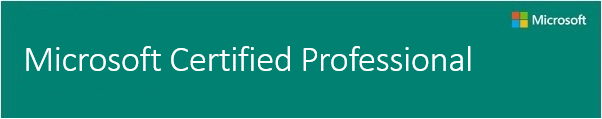

Your next Microsoft Certification exam on-line, nearly anywhere

Take your next Microsoft Certification exam on-line, nearly anywhere

**_Get a free Second Shot when you register for any online proctored MCP and MTA exam_**

Introducing a convenient way to take Microsoft Certification exams at the time and place that's most convenient for you.

Online Proctoring, offered by Pearson VUE, lets you choose the time and place to take any Microsoft Certified Professional (MCP) or Microsoft Technology Associate (MTA) exam. Using a webcam and your personal computer, you can take your exams at home, work or just about anywhere you have internet access.

As a bonus, you'll receive a Second Shot with your eligible* online proctored exam—if you don't pass the first time, take it again for free (available until May 31, 2015).

## How it Works

1. **Register for an online proctored exam.** Choose an MCP or MTA exam ([click here for a full list of exams](http://click.email.microsoftemail.com/?qs=94468dc41612c1d5a36e79c55a8ed0f1d66f130d568ecd97ab5e3cae555ee3bd9275e759db5e7121)). You can schedule your exam with as little as fifteen minutes notice if appointment slots are available.
2. **Set up your testing environment.** You can take online proctored exams at home, at work, or at any other location that meets security and environment requirements. Review the hardware, software, and protocol requirements located [ here](http://click.email.microsoftemail.com/?qs=94468dc41612c1d5bb7557b088ef8a576860e9e47a8806b7e9be0118f12995069ff4140634d6c822). If you ensure that these requirements are met before you check in for your exam, the check-in process should only take about ten minutes.
3. **Check in.** Connect to an assigned greeter, who will verify your identity, review testing rules, and confirm your equipment is properly configured. After check-in, you will be introduced to your proctor, who will monitor your testing session.
4. **Take your exam.** You will have the same amount of time to complete the exam as you would if taking the exam at a Pearson VUE test center. During the exam, your remote proctor will supervise you via webcam and microphone.
5. **Retrieve your score report.** Your exam results will be immediately accessible from your MCP dashboard when you finish your exam. If you don't pass, you have 30 days from the date of the failed exam to schedule your free retake.

## **Availability**

If online proctored delivery is available in your country, online proctored exams are available in all languages that are available at test centers in your country. Please note that greeter and proctor support and proctoring software are currently only available in English.

**[Learn more](http://click.email.microsoftemail.com/?qs=94468dc41612c1d5bb7557b088ef8a576860e9e47a8806b7e9be0118f12995069ff4140634d6c822) about online proctoring, and schedule your exam today!**

*exams eligible for Second Shot have a prefix 70 or 74. Exams with a prefix of 98 are not eligible.

Cheers,

**Marcos Nogueira**
**_MVP_**  
[azurecentric.com](http://azurecentric.com)
Twitter: [@mdnoga](http://www.twitter.com/mdnoga)
