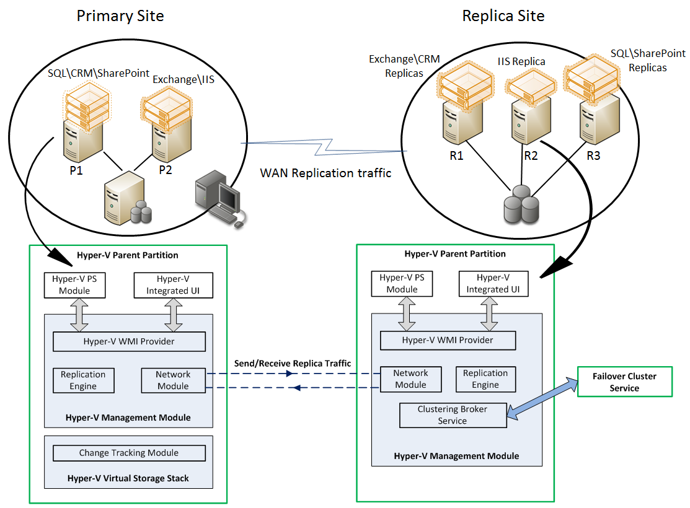

## Prerequisites

To take advantage of the Hyper-V Replica, which is included as part of the Hyper-V server role, the following pre-requisites must be met:
  * Hardware that supports the Hyper-V Role on Windows Server 2012
  * Sufficient storage on both the Primary and Replica servers to host the files used by virtualized workloads
  * Network connectivity between the locations hosting the Primary and Replica servers
  * Properly configured firewall rules to permit replication between the Primary and Replica sites
  * An X.509v3 certificate to support Mutual Authentication with certificates (if desired or needed)

## Functional Description

Administrators can use Hyper-V Replica to provide a virtual machine  level replication solution which efficiently replicates data over a LAN/WAN to a remote (Replica) site without relying on software or hardware technologies outside of the Windows Server 2012 operating system.  At a very high level (details to follow in the Architecture section), Hyper-V Replica is summarized in the following:

  * **Replication Engine:**  The Replication Engine, in many respects, is the 'heart' of Hyper-V Replica.  It manages the replication configuration details and handles initial replication, delta replication, failover, and test-failover operations. It also tracks virtual machine and storage mobility events and takes appropriate actions as needed (i.e. it pauses replication events until migration events complete and then resumes where they left off)
  * **Change Tracking:**  The Change Tracking module provides a virtual machine level change tracking mechanism on the primary server by keeping track of the write-operations, which happen in the virtual machine.  This component is designed in such a way that it makes the scenario work irrespective of where the virtual machine VHD file(s) resides (VHD files can be hosted on Direct Attached Storage (DAS), a SAN LUN, an SMB share on a File Server, or a Cluster Shared Volume (CSV)
  * **Network Module:** The Networking Module provides a secure and efficient (data compression by default) network channel to transfer virtual machine replicas between Primary and Replica site.  Network communications are built on top of HTTP\HTTPS protocols and support integrated as well as certificate-based authentication with optional support for encryption
  * **Hyper-V Replica Broker role:**  The Hyper-V Replica Broker role is configured in a Windows Server 2012 Failover Cluster. This functionality supports seamless replication even in the event of a migration of a replica virtual machine from one cluster node to another.  This is achieved by interacting with the Windows Server Failover Clustering (WSFC) service and the Hyper-V network module. The Hyper-V Replica Broker redirects all virtual machine specific events to the appropriate node in the replica cluster.  The Broker queries the cluster database to determine which node should handle which events.  This ensures all events are redirected to the correct node in the cluster in the event a Quick Migration, Live Migration or Storage Migration process was executed
  * **Management Experience:** This includes the following components:
    * Hyper-V Manager UI: The replication settings are available in the Hyper-V Manager and provide an end-to-end experience for replication configuration, inbox monitoring, test failover, planned failover, unplanned failover and reverse-replication experiences
    * Failover Cluster Manager UI: When Primary or Replica servers are part of a Hyper-V Failover Cluster, all management for the virtual machines and the Hyper-V Replica configurations should be done from the Failover Cluster Manager interface
    * Scripting:  Hyper-V Replica functionality is integrated within the Hyper-V PowerShell Module
    * Hyper-V Replica APIs: These are part of the Hyper-V WMI interface. This interface can also be used by Third Party management software applications
    * Remote Management:  The Hyper-V Manager UI is included as part of the Remote Server Administration Tools (RSAT) that can be installed on supported Windows 8 Consumer Preview operating systems so administrators can remotely manage virtual machine replication

## Security Considerations

There is no requirement for servers running the Hyper-V role to be part of an Active Directory domain unless those servers are part of a Failover Cluster.If the servers are part of an Active Directory domain, then that is a defined security boundary, and it is the responsibility of the Domain Administrator to configure domain-level security policies to protect the domain and to allow Hyper-V to function properly.  Hyper-V Replica can also be implemented between un-trusted domains/workgroups.

Security in Hyper-V is implemented at the following levels:
  * Hyper-V uses a new Simple Authorization model where a Hyper-V Administrators group is created locally on each server running the Hyper-V role when the role is installed. The Authorization Manager is still present, and the Hyper-V Administrators group, along with members of the local administrators group in the server, is added by default
  * Hyper-V administrators can configure Replica servers to accept incoming connections from specific servers, thus restricting access, using a Fully Qualified Domain Name (FQDN) (e.g. P1.contoso.com) or by using a wildcard attached to a domain suffix (e.g. *.contoso.com).  If the Replica server is a Failover Cluster, security is enforced at the cluster level
  *  Firewall rules must be configured to allow incoming connections on the Hyper-V Replica servers for the designated port configured by the Hyper-V Administrator (Refer to Appendix B)
  * Mutual Authentication is accomplished by using Integrated Authentication in an Active directory environment (Kerberos) between trusted domains.  Certificates can be used outside of Active Directory. This would be common in an X-premise environment where a Hosting company is providing DR services to multiple tenants.  Additional security is provided by way of a Replication Authorization Tag.  Consider a scenario where a Hosting company is providing DR services to multiple Third Party Tenants (e.g. Contoso.com, Fabrikam.com and WoodgroveBank.com).  Each of these tenants is using the same Replica Cluster at the Hosting Company's datacenter to host Replica virtual machines.  A Replication Authorization Tag (Security Tag in the UI) is used to prevent one company from gaining access to another company's replica machines.

Cheers,

**Marcos Nogueira**
[azurecentric.com](http://azurecentric.com)
Twitter: [@mdnoga](http://www.twitter.com/mdnoga)
