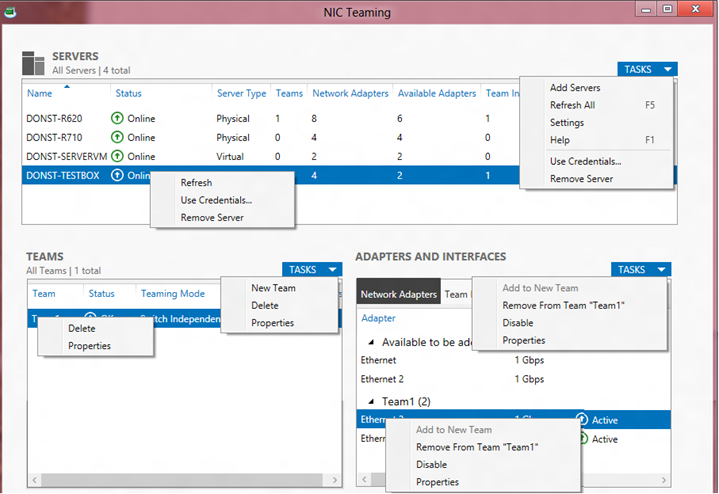

The NIC Teaming management UI consists of 3 primary windows (tiles):
  * The Servers tile
  * The Teams tile
  * The Adapters and Interfaces tile

![clip_image002[5]](/assets/images/posts/2013/04/clip_image0025.png)

The **Adapters and Interfaces tile** is shared by two tabs:
  * The **Network Adapters tab**
  * The **Team Interfaces tab**

Each tile or tab has a set of columns that can be shown or hidden. The column chooser menus are made visible by right-clicking on any column header. (For illustrative purposes the screen shot in the picture bellow shows a column chooser in every tile. Only one column chooser can be active at a time.)

Contents of any tile may be sorted by any column. To sort by a particular column left click on the column title. In the picture bellow the **Servers** tile is sorted by Server Name; the indication is the little triangle in the **Name** column title in the **Servers** tile.

![clip_image004[5]](/assets/images/posts/2013/04/clip_image0045.png)

Each tile also has a **Tasks** dropdown menu and a right-click context menu. The **Tasks** menus can be opened by clicking on the **Tasks** box at the top right corner of the tile and then any available task in the list can be selected. The right-click context menus are activated by right-clicking in the tile. The menu options will vary based on context. (For illustrative purposes the screen shot in the picture bellow shows all the **Tasks** menus and a right-click menu in every tile. Only one right-click menu or **Tasks** menu can be active at any time.). 

In the picture bellow shows the **Tasks** menus and right-click menu for the Team Interfaces tab.

![clip_image007[6]](/assets/images/posts/2013/04/clip_image0076.png)

Cheers,

**Marcos Nogueira**
[azurecentric.com](http://azurecentric.com)
Twitter: [@mdnoga](http://www.twitter.com/mdnoga)
