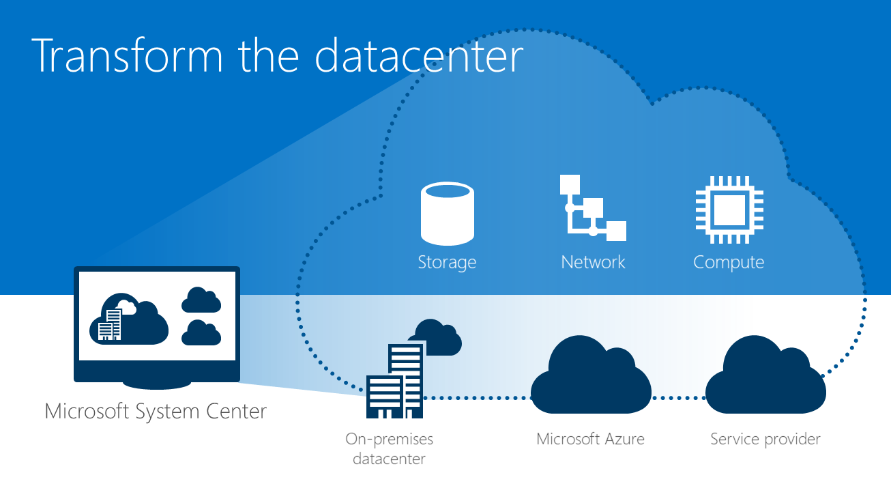

The goal of the series of posts, is based on one of my previous blog post about What we are learning from the cloud ([see here](/posts/what-are-we-learning-from-cloud)). The idea is talk about the datacenter transformation that I’m seeing happening more frequently and fast that we think it’s happen. Organizations are on a fast pace to embrace the Cloud. All the studies are saying that, Gatner, IDC and several others.

I really started to accept this datacenter transformation when Microsoft released the Windows Server 2012 and System Center 2012. For me, and in my opinion, it’s when the Private Cloud started! And you could see with the way that even the System Center was released, at that time became a suite and not more a “bunch” of different and silo products (like the previous versions of the System Center (Example: SCOM 2007 R2, SCVMM 2008 R2, SCCM 2007 R2, etc)). They became components of the System Center suite!

After that, it was obvious what was the direction that the technology leaders were going, to the cloud!

So how can you optimize your infrastructure? There are three areas where you have the opportunity to make changes that will reduce costs, simplify management, and allow you to access the cloud when it makes sense for your organization.
  * **Build a Software-defined Datacenter**
  * **Automate and Secure your infrastructure**
  * **Extend to the cloud on demand**

Cheers,

**Marcos Nogueira**
[azurecentric.com](http://azurecentric.com)
Twitter: [@mdnoga](http://www.twitter.com/mdnoga)
