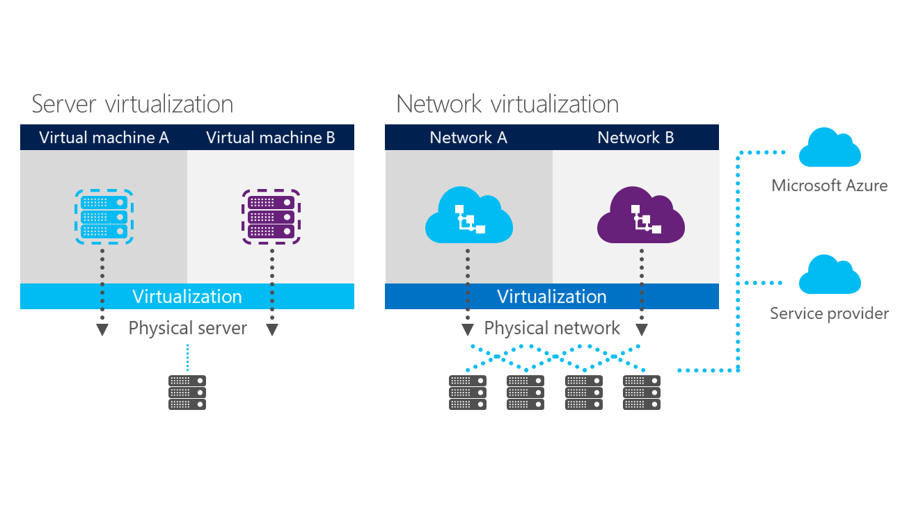

This post is a continuation of series of posts about Transform your datacenter. You can see the previous post [here](/posts/transform-the-datacenter-part-1).

So, the first pillar to transform your datacenter is Software-defined Datacenter.

## **What is Software-defined Datacenter?**

“**_Software-defined_**” has become an industry term—but what does it really mean for us? With a software-defined datacenter, you gain the ability to manage diverse hardware as a unified resource pool. You get greater flexibility and more resilience. That’s the big thing we’re learning from cloud—that to respond rapidly to the demands of the business, you must move away from a highly-customized infrastructure to a standardized, automated infrastructure.

To achieve that you need to rethink the datacenter. On a cloud perspective, all the abstraction layer is resume to three resource that are important to manage and is what you need to build the resource pools that you will allocate to each cloud:
  * **Compute**
  * **Networking**
  * **Storage**

### **Reimagine compute **

Microsoft is once again a leader in the Gartner x86 Virtualization Magic Quadrant. They’re driving innovation in compute with **industry-leading scale and performance**:

Scale to your largest workloads with **64 virtual processors per VM** and 1TB memory per VM

Drive up your consolidation ratio with 320 logical processors per host, 4TB physical memory per host and **1,024 VMs per host**

Increase scale per cluster with** 64 physical nodes per cluster, 8,000 VMs
per cluster**

**Zero-downtime migrations**: Since Windows Server 2012 R2, live migration just gets better.  Live migration is a critical aspect of the software-defined datacenter, because you need the flexibility of moving virtual machines between physical servers with zero downtime. In the latest release of Windows Server, they’ve made it easier to move large numbers of virtual machines—for dynamic load balancing, for example—with the same speed that you expect when moving a single virtual machine.

**Open-source integration**: Directly in Hyper-V, Microsoft have built features to enable live backups for Linux guests, and we have exhaustively tested to ensure that Hyper-V features, like live migration, work for Linux guests just like they do for Windows guests. Since Windows Server 2012 R2, Microsoft engineering teams worked across the board to ensure Linux is at its best on Hyper-V.

**Infrastructure for hardware-based security:** Windows Server also includes multiple features to make it easier to secure data and restrict access.

**Virtualization is the foundation of the software-defined datacenter. Microsoft offers enterprise-grade features and ongoing innovation to allow you to create a flexible, resilient infrastructure fabric.**

### ** ****Reimagine networking**

When we look at datacenter transformation, networking is an area with huge potential. Today’s networks can be rigid, meaning that they make it difficult to move workloads within the infrastructure, and network operations involve high levels of manual processes.

As a result, one of the biggest trends today is software-defined networking (SDN). What exactly does that mean?

A big part of SDN is network virtualization, a capability that Microsoft offer today in Windows Server 2012. Network virtualization does for the network what server virtualization did for compute. It allows you to use software to manage a diverse set of hardware as a single, elastic resource pool. If you then add in additional management capabilities through software, you get a very flexible approach.

And the benefits are very similar for networking. With compute capacity, we see with the private cloud model how virtualization gives you increased flexibility in moving workloads and allocating capacity. You get greater efficiency when you have this increased ability to balance the load across your existing resources.

**With Windows Server 2012 R2 and System Center 2012 R2 Virtual Machine Manager, your network becomes a pooled resource that can be defined by software, managed centrally through automation, and extended beyond your datacenter.**

Networking today is complicated because the underlying physical network hardware such as ports, switches, and routers tends to require manual configuration. Network operations are often complex since the management interfaces to configure and provision network devices tend to be proprietary; in many cases, network configuration needs to happen on a per-device basis, making it difficult to maintain an end-to-end operational view of your network.

With a virtualized network infrastructure, you can control the building of the network, configuration, and traffic-routing using software. You can manage your network infrastructure as a unified whole, and that allows you to do three very important things: you can isolate what you need to isolate, you can move what you need to move, and you can build connections between your datacenter and cloud resources.

**Isolate:**

So, let’s first talk about isolation. We’ve talked a lot about the importance of a unified resource pool, but there are many reasons why you might want to create divisions or partitions within that pool. For example, you might want to separate individual departments. As companies increasingly rely on central datacenters to support global operations, you might also want to separate geographical regions. Today, some companies create separate areas for physical servers, designated to particular geographically, within the datacenter. But that isn’t a very efficient usage model, and it doesn’t give you many options if that set of servers experiences problems. With network virtualization, or software-defined networking, you can create boundaries within the datacenter to enable multi-tenancy and keep workloads isolated from each other without placing them in separate hardware pools.

What else can you do with a virtualized network infrastructure?

**Move:**

In the past, individual workloads were pretty tightly coupled to the underlying physical network infrastructure. That meant that moving workloads within the datacenter required extensive manual reconfiguration. Network virtualization lets you move workloads even from one datacenter to another because the control plane for the network is all handled through software. Microsoft have several features in Windows Server 2012 and Windows Server 2012 R2 that combine to make that process even easier.

**Connect to clouds:**

And finally, software-defined networking lets you connect easily to clouds outside your datacenter.  It allows you to treat cloud resources as an extension of your own infrastructure—so in a way, you could say that SDN and network virtualization are the keys to hybrid cloud.  That’s why Microsoft continue to invest so heavily in this area.

### **Reimagine storage**

Organizations continue to face storage pain. Although storage cost-per-TB continues to fall, the demand for storage is growing much faster—35 to 50+percent annually. This only increases the pressure on business as storage spend outpaces server spend—or IT budgets—and introduces a chain of costs, and more pain.

Microsoft want to provide customers with ways to improve their storage infrastructure and how they leverage it, regardless of their current storage environment. We need to create strategic options using cloud technologies that lead to lasting solutions.

Those include continuing with traditional storage investments and optimizing them, or integrating new options for next-generation on-premises (private cloud) or hybrid cloud storage.

Many Organizations have existing storage and technology investments that they wish to maintain—example: direct-attached storage, storage area networks (SAN), network-attached storage (NAS), and data protection infrastructure.

But you don’t need a SAN for every purpose.

**Cost-effective storage for private clouds **

Today most organizations have virtualized compute. As we discussed earlier, whatever your hypervisor, live migration is a key capability and historically, organizations have used a SAN to support that. But Microsoft have introduced new options for customers’ primary storage:
providing the performance and availability required **to use file storage as a back end for virtualization workloads.**

This is possible through a set of technologies, including:
  * SMB 3 protocol updates that improve network file share performance
  * New load-balanced active-active file server clusters (Scale-out File Server (SoFS))
  * Introducing SMB Transparent Failover for the clusters so that the servers relying on them can run uninterrupted, even in the event that a node fails

Employing and managing file-based storage will be very cost-effective for many private cloud deployments. Data protection management solution provides support for shared-nothing live migration in these environments. VMs can move freely, remaining protected while using resources efficiently.

Cheers,

**Marcos Nogueira**
[azurecentric.com](http://azurecentric.com)
Twitter: [@mdnoga](http://www.twitter.com/mdnoga)
