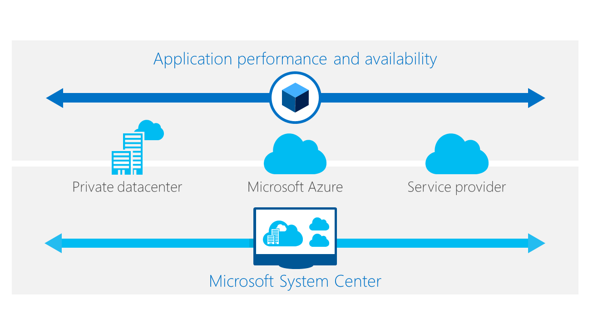

I’ve talked about the infrastructure fabric, and how there are enhancements available in Windows Server 2012 R2 on the previous blog post (see here). But how do you think about the services that run on top of that infrastructure? How do you ensure that you’re managing effectively and building security into your processes?

## **Build and operate**

Building the right platform is only half of what you need to do to support the changing needs of your business. The next big piece is operations (operations fundamental to Software-defined datacenter (SDDC), not an add-on layer on top)—the way that you bring new resources in, deliver applications and services to the business, meet demanding SLAs, and ensure that you’re meeting requirements for security and compliance.

Going back to the learnings from cloud (see here), you need to bring standardization and automation to core processes. But you also need to rethink security, because the pooling of resources in a private cloud model creates issues of access control. For on-demand self-service, you must think about who has the ability to demand, provision, use or request services. In this post, we’ll talk more about identity as part of your security strategy. The critical thing to note here is that as you transform the datacenter to take advantage of innovation, security should be part of the picture. The security features in Windows Server 2012 R2 are second to none

Beyond security, how can you be sure that you are operating your infrastructure efficiently, without wasting time or resources? The solution is a unified approach to management.

## **Unified management**

Unified management means a single approach and a single console that lets you provision, deploy, monitor, and manage. It’s a key part of a “cloud operations” or “software-defined datacenter” approach: management is the intelligence within the system.

For provisioning, you’re looking for an approach that lets you avoid repetitive processes—so that you can deploy servers and applications rapidly and without errors.

You also want a robust set of tools for monitoring and management. Modern applications are often highly distributed and management means tools that can take into account the stack from the metal up.

And you want the right tools for service delivery, with a consistent experience across clouds.

## **Provisioning**

### **Infrastructure**

With the right processes and technology in place, you can take a new server, rack it, attach a network cable, and within 15 minutes have it be part of the running infrastructure as the system:
  * Discovers
  * Interrogates
  * Deploys the OS
  * Configures the server as part of its workload role

### ** ****Applications**

For stable, resilient, reliable workloads, you need to focus on the creation of templates for application provisioning. You can then automate triggers for scale up or scale down.

By using templates and automating repetitive processes, you can increase speed without introducing risk into the system.

## **Management and monitoring**

You need to monitor from the hardware up to the application—to allow you to determine where a problem really exists. You should know whether it’s an issue with the SAN or an issue with the server or an issue with the database.

System Center 2012 R2 lets you monitor your on-premises datacenter and also monitor the health of your subscription services in Azure.

Microsoft offers distributed application performance monitoring, so you can verify the health, performance, and availability of applications in a hybrid environment.

Intelligent monitoring means that in a private datacenter, you’ll monitor all the way down the stack, in Azure you would only monitor the service.

## **Service delivery**

The final key element when thinking about the software-defined datacenter is service delivery. How do you get your users the resources they need—whether they are developers or LOB application owners? A great approach to service delivery should allow you add in cloud resources to your infrastructure in a hybrid model, so that you’re automatically drawing capacity. A strong service delivery model also allows you to pre-approve compute/storage/network resources to designated users, so that authorization isn’t a roadblock.

Microsoft Azure Pack provides a multi-tenant, self-service cloud that works on top of your existing software and hardware investments. Building on the familiar foundation of Windows Server and System Center, Microsoft Azure Pack offers a flexible and familiar solution that your business can take advantage of to deliver self-service provisioning and management of infrastructure—Infrastructure as a service (Iaas), and application services—Platform as a Service (PaaS), such as Web Sites and Virtual Machines.

With the Azure Pack, you can standardize IT service offerings, empowering users to directly identify, access, and request applications and services published through a centralized configuration management database. Provide a self-service portal with a provisioning and delegation framework, along with chargeback and compliance management and reporting capabilities.

## **Microsoft Cloud Platform System**

The Cloud Platform System is a revolutionary new product designed specifically to reduce the complexity and risk of implementing a hybrid cloud—and to get you up and running fast. This appliance includes both the hardware and the software you need to create the agile datacenter of the future—specifically, Windows Server 2012 R2, Microsoft System Center 2012 R2, and Microsoft Azure technologies. Preconfigured hardware and software working together speeds your ability to offer customers the infrastructure as a service (IaaS) and platform as a service (PaaS) resources they want, whether that means self-provisioned virtual machines, web applications, or other resources. You simply choose the configuration you want.

Cheers,

**Marcos Nogueira**
[azurecentric.com](http://azurecentric.com)
Twitter: [@mdnoga](http://www.twitter.com/mdnoga)
