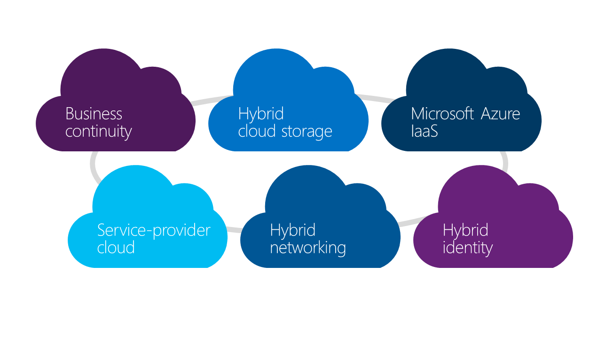
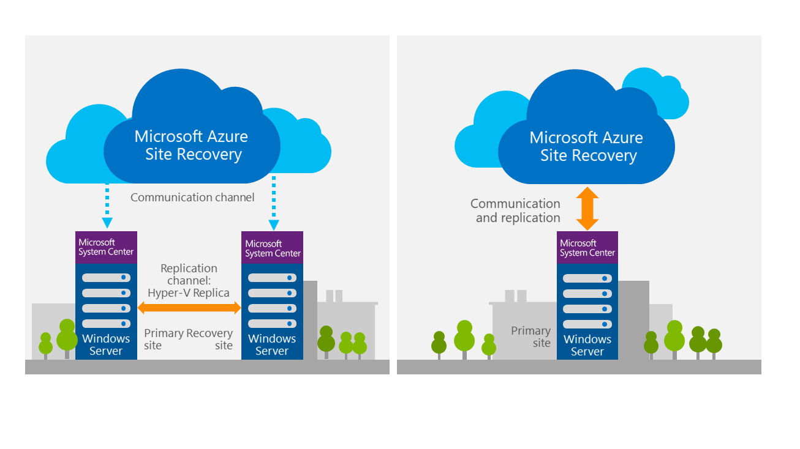
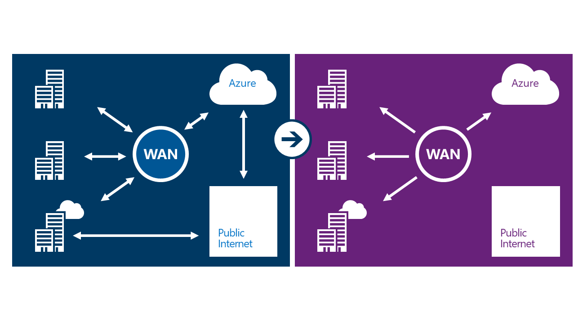
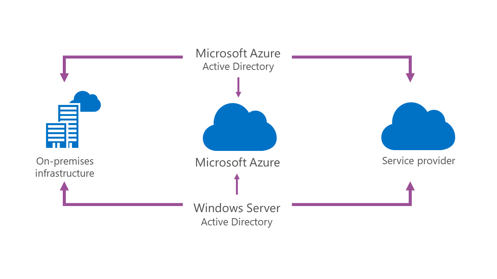

This post is a continuation of series of posts about Transform your datacenter. You can see the previous post:
  * [Transform the Datacenter – Part 1](/posts/transform-the-datacenter-part-1)
  * [Transform the Datacenter – Part 2 – Software-defined Datacenter](/posts/transform-the-datacenter-part-2-software-defined-datacenter) 	
  * [Transform the Datacenter – Part 3 – Automate and Secure](/posts/transform-the-datacenter-part-3-automate-and-secure)

Extend into the cloud to scale on demand while keeping costs low and the complexity of the solution simple is the major challenge when you think to extend your datacenter to the cloud. You can meet unexpected needs or plan ahead for times when your business needs to run at peak demand.

One of the first thing that comes to my mind, when I’m talking to extend the datacenter to the cloud is security and how I can trust on the cloud provider.

## **Microsoft Azure security and trust**

From all the public cloud providers, as per mu knowledge, Microsoft Azure is the one that have more security and clearance certifications. With the recent new division that Microsoft created (Cybercrime), Security is one of the top priorities. Just look how much they invest in security. For me that give me a boost on my confidence regarding my infrastructure.

These are the topics that concern me the most and I always look for on a public cloud provider:

### **Security**

  * Secure development, operations, and threat mitigation practices provide a trusted foundation 	
  * Decades of experience building enterprise software & operating online services around the globe
  * Physical and platform security measures including access control, encryption, and network safeguards
  * Defense-in-depth and penetration testing help protect against cyber threats

### ** Privacy**

  * Unmatched legal commitments govern data privacy, access and use 	
  * First to offer privacy protections via Data Processing Agreements, EU Model Clauses, and HIPAA BAA
  * No mining of customer data for advertising or other purposes
  * Customers control where their data resides and who has access to it

### **Compliance**
 	
  * Independent audits demonstrate compliance with regulatory standards 	
  * Certified for ISO, SSAE 16/SOC 1, and SOC 2 compliance, plus a range of industry and country specific security standards
  * Shares audit report findings and compliance packages with customers

## **Make hybrid capabilities part of your infrastructure**

When we talk about the concrete benefits of hybrid, there are a number of areas to consider. IT Professionals often ask, “Where should I start,” so I’ve picked some of the places where you can most easily take advantage of cloud resources as an extension of your existing datacenter.

### **Microsoft Azure Infrastructure as a Service **

That is one of the most truly reason of why Microsoft Azure is your hybrid cloud solution, if you compare to other public cloud providers. The consistent VM format between Hyper-V and Azure IaaS (for example), makes it easy to move existing applications to the cloud.

Scalable on demand and enterprise ready are other points to take in consideration, but if you compare with the other public cloud providers. The different is almost nothing.

### **Service provider cloud options**

The Cloud OS Network is a **worldwide group of select Service Providers** that partner closely with Microsoft to offer organizations cloud solutions on the Microsoft Cloud Platform (Hyper-V, System Center, Windows Azure Pack) and Azure enabled solutions.

Cloud OS Network members are uniquely combining **geographically affinity** (Data Sovereignty, local Datacenters), **value added services** (Customer centric solutions, Azure enabled scenarios) and **customer reach/relationship**. Microsoft have now 100+ partners in the network to serve your specific needs, covering over 600 local datacenters and serving over 3.7mio customers.
_[Find a COSN partner](http://www.microsoft.com/en-us/server-cloud/cloud-os-network.aspx)_ in your region or join the conversation on Twitter @CloudOSNetwork.

### **Hybrid Cloud storage**

Be able to reduce storage costs and manage data growth. Improve your data protection and recovery or even increase agility and shift resources to business drivers is some of the features of Microsoft Storsimple solution.

### **Business continuity**

The goals, that Microsoft have, when building a cloud-based disaster recovery solution were to make disaster recovery available to everyone, available everywhere, and easy to use. That is where Azure Site Recovery is coming to place.

To have more information about Azure Site Recovery, see this post.

## **Hybrid networking**

Azure ExpressRoute enables you to create private connections between Azure datacenters and infrastructure that’s on your premises or in a colocation environment. ExpressRoute connections do not go over the public Internet, and offer more reliability, faster speeds, lower latencies and higher security than typical connections over the internet. In some cases, using ExpressRoute connections to transfer data between on-premises and Azure can also yield significant cost benefits.

Express Route: connect directly to Azure from your datacenter, without going through the public internet.

With ExpressRoute, you can establish connections to Azure at an ExpressRoute location (Exchange Provider facility) or directly connect to Azure from your existing WAN network (such as a MPLS VPN) provided by a network service provider.

### **Hybrid identity**

For identity and access, the breakthrough is an increased ability to maintain a single identity across multiple clouds. Continuous services and connected devices present a real challenge, with users expecting more and more from IT in terms of simple and fast access to resources and data. Microsoft offers multiple options in this area, including the advances in identity management in both Windows Server 2012 Active Directory and Microsoft Azure Active Directory. Cloud-based identity that integrates with your existing Active Directory solution will allow tremendous flexibility in building single sign-on capabilities across your cloud deployments. This is the identity platform you know, reinvented for cloud.

Microsoft is differentiated in this area by our ability to bridge from the on-premises datacenter to the cloud.  We understand that you need to balance security and compliance against ease of access for end users.  And we continue to innovate to make things easier—for example, the most recent updates to Azure Active Directory make it possible to federate identity across SaaS applications, such as Salesforce.com

Cheers,

**Marcos Nogueira**
[azurecentric.com](http://azurecentric.com)
Twitter: [@mdnoga](http://www.twitter.com/mdnoga)
