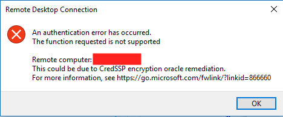

After patching all the Windows Server in Azure, a colleague calls me in panic, because their users, could not access their VMs through RDP. They were getting a CredSSP error (picture bellow).



So, after reading the link bellow, it seems it could be related with the March update.
[https://support.microsoft.com/en-us/help/4093492/credssp-updates-for-cve-2018-0886-march-13-2018](https://support.microsoft.com/en-us/help/4093492/credssp-updates-for-cve-2018-0886-march-13-2018)

Rebooting the VM didn’t sort the issue, there’s a few mitigations listed in this post
[https://blogs.technet.microsoft.com/mckittrick/unable-to-rdp-to-virtual-machine-credssp-encryption-oracle-remediation/](https://blogs.technet.microsoft.com/mckittrick/unable-to-rdp-to-virtual-machine-credssp-encryption-oracle-remediation/)

Then I realize that was a simple solution for an organization. What about all of those situations that your Azure VM is not domain join, like “Jump Servers”? I’m wondering if you have a single VM in a subscription for whatever reason, and a Windows update or any other issue blocks RDP because security issues, what’s the recommended way to connect to such a virtual machine?

One of the first things you should try is to disable the NLA, you can try to do it following these steps:

1. Open regedit on another virtual machine on the same network.  
2. Under the File menu click “Connect Network Registry…”  
3. Enter your computer name and click Ok.  If this fails to connect you try the way through command line (see the post [How to remotely disable Network Level Authentication (NLA) on Azure Virtual Machine](/posts/how-to-remotely-disable-network-level-authentication-nla-on-azure-virtual-machine))
4. Scroll down in the left pane to find the newly added server. Navigate to this Key: 
```
HKEY_LOCAL_MACHINE\SYSTEM\CurrentControlSet\Control\Terminal
Server\WinStations\RDP-Tcp
``` 
5. Find the value “SecurityLayer” and change the data to **_0_**  
6. Try to RDP. In case of failure, reboot the VM and try again.

Cheers,

**Marcos Nogueira**  
**_Azure MVP_**  
[azurecentric.com](http://azurecentric.com)  
Twitter: [@mdnoga](http://www.twitter.com/mdnoga)
