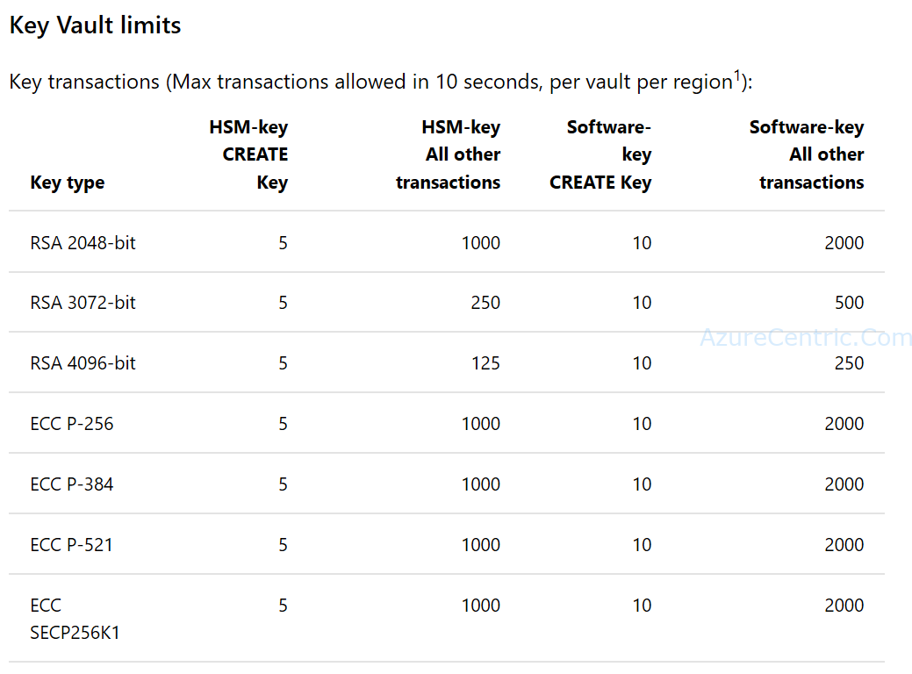

When you are designing the architecture for your application on Azure, I always revisit the [Azure Subscription Service Limits](https://docs.microsoft.com/en-us/azure/azure-subscription-service-limits?toc=/azure/billing/TOC.json) to see if all the requirements are not over the Azure Limits.

Although, this time after evaluating and discussing with the team the [Key Vault Limits](https://docs.microsoft.com/en-us/azure/azure-subscription-service-limits#key-vault-limits), to be more precise the number key transactions that application is allowing to use regarding each type of key, I have to say that was a bit confusing.

So, this are the Key Vault limits that Azure have at the present moment:

After reading sometimes, and clarify within the team, I finally got it. Each number of transactions is for a period of 10 seconds. 

### What is that means?

Lets take the example of RSA-HSM-4k, in a 10 secs interval you are allow only 125 transactions. On the 126th transaction on the same 10 sec period, you will get a Key Vault exception. But this counter it will reset every 10 secs of the first transaction. All those limits are per region. In this case if you need more than what is set as a limit, it’s recommended that you deploy your application and your Key Vault key in different regions, so you can have load balance and not cause any error on your application with an Key Vault exception.

Cheers,

**Marcos Nogueira**  
**_Azure MVP_**  
[azurecentric.com](http://azurecentric.com)  
Twitter: [@mdnoga](http://www.twitter.com/mdnoga)
