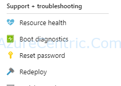
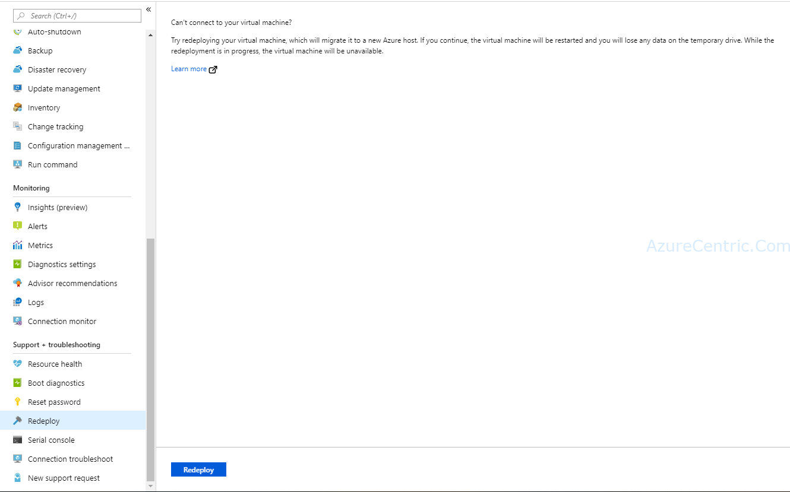
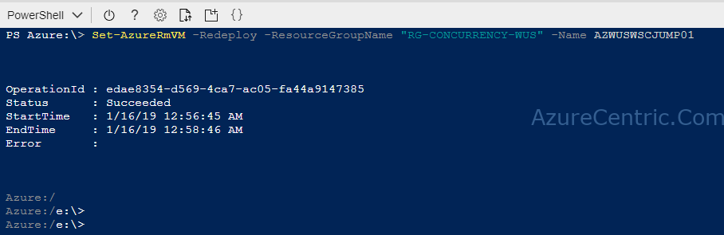

Another day I was at one of my costumers, and a system engineer come to me asking me if I could help him troubleshoot an issue with an unresponsive Azure VM. I love this moments, specially when I can always learn new ways that users are using Azure.

OK, lets move to the issue. Here is the list of issues that he reports to me:
  * No RDP into VM
  * VM not “pingable” from the network (either on prem or on Azure)
  * Remote PowerShell not available

Usually when this kind of issues happen, I always recommend to redeploy (see picture below).

But what does the redeploy on an Azure VM does to fix the issue. Sometimes the VM running on the host/node on Azure, get “stuck” on a state that makes the VM seems inaccessible from the network, although from the monitoring the VM is still running. By redeploy the Azure VM, you are redeploying the VM on another host/node in the same Azure datacenter. 

What this mean? Means that Azure will shutdown automatically your VM, move it to another host/node available with the capacity to run and then power it back. All of this process will retain the configuration, the resources associated and the disks.

## **How to redeploy an Azure VM**

You have to option, either through the Azure Portal or through PowerShell

### Azure Portal



  1. On Azure Portal, navigate to the VM. Down on the left under **Support + troubleshooting** area, you will find the Redeploy.  



  2. When you select Redeploy, it will appear a page explaining what will happen. Then click Redeploy  

  3. After that you will see the status the VM changing to Updating. When the status change to Running the redeploy is finish and now you can access the VM.

### PowerShell

If you want to use the Azure Cloud Shell or the PowerShell on your machine the command is the same.
```powershell
Set-AzureRmVM -Redeploy -ResourceGroupName "<RESOURCE_GROUP>" -Name "<VM_Name>"
```



Cheers,

**Marcos Nogueira**  
**_Azure MVP_**  
[azurecentric.com](http://azurecentric.com)  
Twitter: [@mdnoga](http://www.twitter.com/mdnoga)
