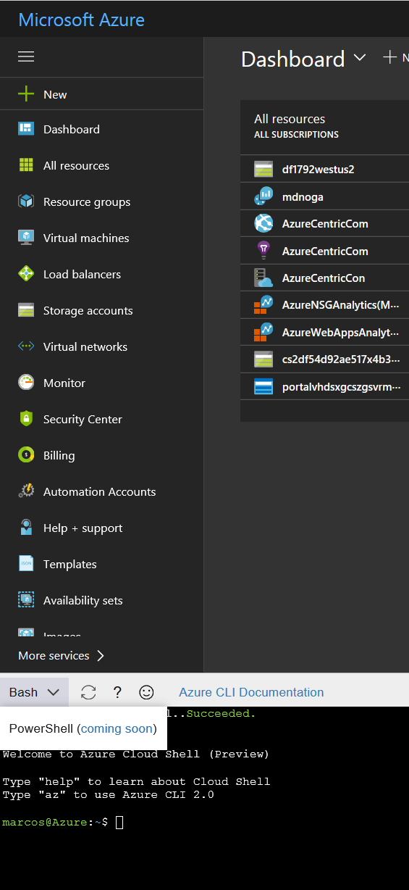

On the past May 10th, during the keynote of the Microsoft Build 2017 Conference in Seattle (WA), Microsoft announce the Azure Cloud Shell (see post here). Although on the May 4th when I enter at the Azure Portal I saw already the Azure Cloud Shell. Since that day, I was eager to start playing with Azure Cloud Shell, specially using PowerShell.

But it’s not yet available (at least for me). So, if you are like me, and follow the news and all the blogs related, at the Azure Blog they are giving a sneak peak of the power of the PowerShell on Azure Cloud Shell (see the post [here](https://azure.microsoft.com/en-us/blog/sneak-peek-powershell-in-azure-cloud-shell/)).

On the blog post, they said the PowerShell experience will be the same as the Bash experience, where you will:
  * Get **authenticated shell access** to Azure **from virtually anywhere**.
  * Use **common tools and programming languages** in a shell that’s updated and maintained by Microsoft.
  * **Persist your files across sessions** in attached Azure File storage.

Additionally, the PowerShell experience will provide: 	
  * **Azure namespace** capability to let you easily discover and navigate all Azure resources.
  * **Interaction with VMs** to enable seamless management into the guest VMs.
  * **Extensible model** to import additional cmdlets and ability to run any executable.

But, on the bottom of that post there the magic gate to have access to this wonderful and Powerful world of using PowerShell on Azure Cloud Shell. So, if you want (like me), to start using Azure Cloud Shell, [Sign-up here](https://aka.ms/PSCloudSignup) to participate in a limited preview of PowerShell in Azure Cloud Shell.

Cheers,

**Marcos Nogueira**
[azurecentric.com](http://azurecentric.com)
Twitter: [@mdnoga](http://www.twitter.com/mdnoga)
