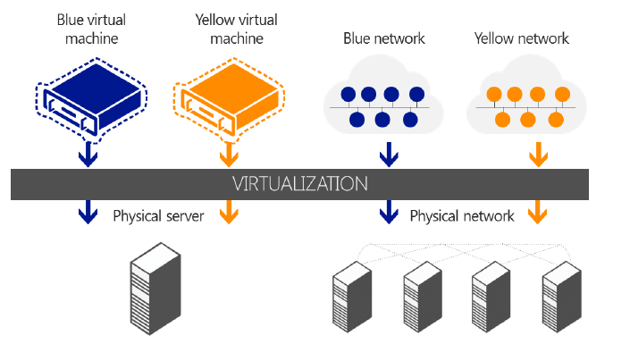
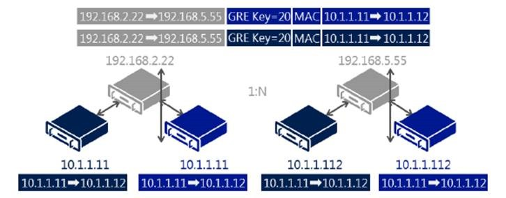
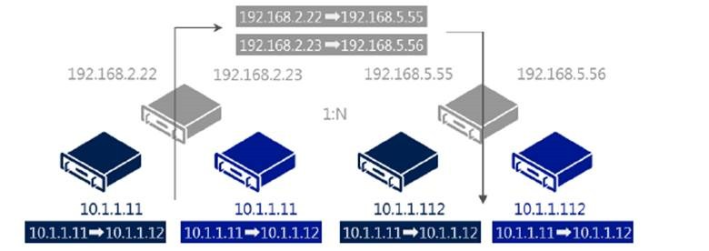
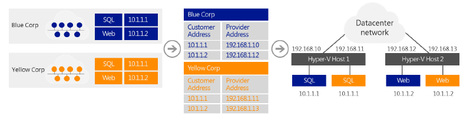

Isolating different departments’ virtual machines can be a challenge on a shared network. When entire networks of virtual machines must be isolated, the challenge becomes even greater. Traditionally, VLANs have been used to isolate networks, but VLANs are very complex to manage on a large scale. The following are the primary drawbacks of VLANs: 
    * Cumbersome reconfiguration of production switches is required whenever virtual machines or isolation boundaries must be moved. Moreover, frequent reconfigurations of the physical network to add or modify VLANs increases the risk of an outage. 
    * VLANs have limited scalability because typical switches support no more than 1,000 VLAN IDs (with a maximum of 4,095). 
    * VLANs cannot span multiple subnets, which limits the number of nodes in a single VLAN and restricts the placement of virtual machines based on physical location. 

In addition to these drawbacks, virtual machine IP address assignment presents other key issues when organizations move to the cloud: 
    * Required renumbering of service workloads. 
    * Policies that are tied to IP addresses. 
    * Physical locations that determine virtual machine IP addresses. 
    * Topological dependency of virtual machine deployment and traffic isolation. 

The IP address is the fundamental address that is used for layer-3 network communication because most network traffic is TCP/IP. Unfortunately, when moving to the cloud, the addresses must be changed to accommodate the physical and topological restrictions of the datacenter. Renumbering IP addresses is cumbersome because all associated policies that are based on IP addresses must also be updated. 

The physical layout of a datacenter influences the permissible potential IP addresses for virtual machines that run on a specific server or blade that is connected to a specific rack in the datacenter. A virtual machine provisioned and placed in the datacenter must adhere to the choices and restrictions regarding its IP address. The typical result is that datacenter administrators assign IP addresses to the virtual machines and force virtual machine owners to adjust all the policies that were based on the original IP address. This renumbering overhead is so high that many enterprises choose to deploy only new services into the cloud and leave legacy applications unchanged. 

To solve these problems, Windows Server 2012 introduces Hyper-V Network Virtualization, a new feature that enables you to isolate network traffic from different business units or customers on a shared infrastructure, without having to use VLANs. Network Virtualization also lets you move virtual machines as needed within your virtual infrastructure while preserving their virtual network assignments. You can even use Network Virtualization to transparently integrate these private networks into a pre-existing infrastructure on another site. 

Hyper-V Network Virtualization extends the concept of server virtualization to permit multiple virtual networks, potentially with overlapping IP addresses, to be deployed on the same physical network. With Network Virtualization, you can set policies that isolate traffic in a dedicated virtual network independently of the physical infrastructure. The following figure illustrates how you can use Network Virtualization to isolate network traffic that belongs to two different customers. In the figure, a Blue virtual machine and a Yellow virtual machine are hosted on a single physical network, or even on the same physical server. However, because they belong to separate Blue and Yellow virtual networks, the virtual machines cannot communicate with each other even if the customers assign these virtual machines IP addresses from the same address space.

To virtualize the network, Hyper-V Network Virtualization uses the following elements: 
    * Two IP addresses for each virtual machine. 
    * Generic Routing Encapsulation (GRE). 
    * IP address rewrite. 
    * Policy management server. 

## **IP addresses**

Each virtual machine is assigned two IP addresses: 
    * **Customer Address (CA)** is the IP address that the customer assigns based on the customer’s own intranet infrastructure. This address lets the customer exchange network traffic with the virtual machine as if it had not been moved to a public or private cloud. The CA is visible to the virtual machine and reachable by the customer. 
    * **Provider Address (PA)** is the IP address that the host assigns based on the host’s physical network infrastructure. The PA appears in the packets on the wire exchanged with the Hyper-V server hosting the virtual machine. The PA is visible on the physical network, but not to the virtual machine. 

The layer of CAs is consistent with the customer's network topology, which is virtualized and decoupled from the underlying physical network addresses, as implemented by the layer of PAs. With Network Virtualization, any virtual machine workload can be executed without modification on any Windows Server 2012 Hyper-V server within any physical subnet, if Hyper-V servers have the appropriate policy settings that can map between the two addresses. 

This approach provides many benefits, including cross-subnet live migration, customer virtual machines running IPv4 while the host provider runs an IPv6 datacenter or vice-versa, and using IP address ranges that overlap between customers. But perhaps the biggest advantage of having separate CAs and PAs is that it lets customers move their virtual machines to the cloud with minimal reconfiguration. 

## **Generic Routing Encapsulation **

GRE is a tunneling protocol (defined by RFC 2784 and RFC 2890) that encapsulates various network layer protocols inside virtual point-to-point links over an Internet Protocol network. Hyper-V Network Virtualization in Windows Server 2012 uses GRE IP packets to map the virtual network to the physical network. The GRE IP packet contains the following information: 
    * One customer address per virtual machine. 
    * One provider address per host that all virtual machines on the host share. 
    * A Tenant Network ID embedded in the GRE header Key field. 
    * Full MAC header. 

The following figure illustrates GRE in a Network Virtualization environment.

## **IP Address Rewrite **

Hyper-V Network Virtualization uses IP Address Rewrite to map the CA to the PA. Each virtual machine CA is mapped to a unique host PA. This information is sent in regular TCP/IP packets on the wire. With IP Address Rewrite, there is little need to upgrade existing network adapters, switches, and network appliances, and it is immediately and incrementally deployable today with little impact on performance. The following figure illustrates the IP Address Rewrite process.

## **Policy management server**

The setting and maintenance of Network Virtualization capabilities require using a policy management server, which may be integrated into the management tools used to manage virtual machines. 

## **Network Virtualization example **

Blue Corp and Yellow Corp are two companies that want to move their Microsoft SQL Server infrastructures into the cloud, but they want to maintain their current IP addressing. Thanks to the new Network Virtualization feature of Hyper-V in Windows Server 2012, Cloud is able to accommodate this request, as shown in the following figure.

Before moving to the hosting provider's shared cloud service: 

* Blue Corp ran a SQL Server instance (named SQL) at the IP address 10.1.1.1 and a web server (named WEB) at the IP address 10.1.1.2, which uses its SQL server for database transactions. 

* Yellow Corp ran a SQL Server instance, also named SQL and assigned the IP address 10.1.1.1, and a web server, also named WEB and also at the IP address 10.1.1.2, which uses its SQL server for database transactions. 

Both Blue Corp and Yellow Corp move their respective SQL and WEB servers to the same hosting provider's shared IaaS service where they run the SQL virtual machines in Hyper-V Host 1 and the WEB virtual machines in Hyper-V Host 2. All virtual machines maintain their original intranet IP addresses (their CAs): 
    * CAs of Blue Corp virtual machines: SQL is 10.1.1.1, WEB is 10.1.1.2. 
    * CAs of Yellow Corp virtual machines: SQL is 10.1.1.1, WEB is 10.1.1.2. 

Both companies are assigned the following PAs by their hosting provider when the virtual machines are provisioned: 
    * PAs of Blue Corp virtual machines: SQL is 192.168.1.10, WEB is 192.168.1.12. 
    * PAs of Yellow Corp virtual machines: SQL is 192.168.1.11, WEB is 192.168.1.13. 

The hosting provider creates policy settings that consist of an isolation group for Yellow Corp that maps the CAs of the Yellow Corp virtual machines to their assigned PAs, and a separate isolation group for Blue Corp that maps the CAs of the Blue Corp virtual machines to their assigned PAs. The provider applies these policy settings to both Hyper-V Host 1 and Hyper-V Host 2. 

When the Blue Corp WEB virtual machine on Hyper-V Host 2 queries its SQL server at 10.1.1.1, the following occurs: 
* Hyper-V Host 2, based on its policy settings, translates the addresses in the packet from:
    **Source:** 10.1.1.2 (the CA of Blue Corp WEB)
    **Destination:** 10.1.1.1 (the CA of Blue Corp SQL)
    _to_
    **Source:** 192.168.1.12 (the PA for Blue Corp WEB)
    **Destination:** 192.168.1.10 (the PA for Blue Corp SQL) 

* When the packet is received at Hyper-V Host 1, based on its policy settings, Network Virtualization translates the addresses in the packet from:
    **Source:** 192.168.1.12 (the PA for Blue Corp WEB)
    **Destination:** 192.168.1.10 (the PA for Blue Corp SQL)
    _back to_
    **Source:** 10.1.1.2 (the CA of Blue Corp WEB)
    **Destination:** 10.1.1.1 (the CA of Blue Corp SQL) _before delivering the packet to the Blue Corp SQL virtual machine._

When the Blue Corp SQL virtual machine on Hyper-V Host 1 responds to the query, the following happens: 

* Hyper-V Host 1, based on its policy settings, translates the addresses in the packet from:
    **Source:** 10.1.1.1 (the CA of Blue Corp SQL)
    **Destination:** 10.1.1.2 (the CA of Blue Corp WEB)
    _to_
    _**Source:** 192.168.1.10 (the PA for Blue Corp SQL)
    **Destination:** 192.168.1.12 (the PA for Blue Corp WEB) 

* When Hyper-V Host 2 receives the packet, based on its policy settings, Network Virtualization translates the addresses in the packet from:
    **Source:** 192.168.1.10 (the PA for Blue Corp SQL) 
    **Destination:** 192.168.1.12 (the PA for Blue Corp WEB)
    _to_
    **Source:** 10.1.1.1 (the CA of Blue Corp SQL)
    **Destination:** 10.1.1.2 (the CA of Blue Corp WEB) _before delivering the packet to the Blue Corp WEB virtual machine._

A similar process for traffic between the Yellow Corp WEB and SQL virtual machines uses the settings in the Yellow Corp isolation group. With Network Virtualization, Yellow Corp and Blue Corp virtual machines interact as if they were on their original intranets, but they are never in communication with each other, even though they are using the same IP addresses. The separate addresses (CAs and PAs), the policy settings of the Hyper-V hosts, and the address translation between CA and PA for inbound and outbound virtual machine traffic, all act to isolate these two sets of servers from each other. 

Setting and maintaining Network Virtualization capabilities requires the use of a policy management server, which may be integrated into tools used to manage virtual machines. 

Two techniques are used to virtualize the IP address of the virtual machine. The preceding example with Blue Corp and Yellow Corp shows IP Rewrite, which modifies the CA IP address of the virtual machine’s packets before they are transferred on the physical network. IP Rewrite can provide better performance because it is compatible with existing Windows networking offload technologies such as VMQs. 

The second IP virtualization technique is GRE Encapsulation (RFC 2784). With GRE Encapsulation, all virtual machines packets are encapsulated with a new header before being sent on the wire. GRE Encapsulation provides better network scalability because all virtual machines on a specific host can share the same PA IP address. Reducing the number of PAs means that the load on the network infrastructure associated with learning these addresses (IP and MAC) is greatly reduced.

## **Requirements** 

Network Virtualization requires Windows Server 2012 and the Hyper-V server role. 

## **Summary** 

With Network Virtualization, you now can isolate network traffic from different business units or customers on a shared infrastructure, without having to use VLANs. Network Virtualization also lets you move virtual machines as needed within your virtual infrastructure while preserving their virtual network assignments. Finally, you can use Network Virtualization to transparently integrate these private networks into a pre-existing infrastructure on another site. 

Network Virtualization benefits include: 
    * **Tenant network migration to the cloud with minimum reconfiguration or effect on isolation**. Customers can keep their internal IP addresses while they move workloads onto shared IaaS clouds, minimizing the configuration changes needed for IP addresses, DNS names, security policies, and virtual machine configurations. In software-defined, policy-based datacenter networks, network traffic isolation does not depend on VLANs, but is enforced within Hyper-V hosts, based on multitenant isolation policies. Network administrators can still use VLANs for traffic management of the physical infrastructure if the topology is primarily static. 
    * **Tenant virtual machine deployment anywhere in the datacenter**. Services and workloads can be placed or migrated to any server in the datacenter while keeping their IP addresses, without being limited to physical IP subnet hierarchy or VLAN configurations. 
    * **Simplified network and improved server/network resource use**. The rigidity of VLANs, along with the dependency of virtual machine placement on physical network infrastructure, results in overprovisioning and underuse. By breaking this dependency, Virtual Server Virtual Networking increases the flexibility of virtual machine workload placement, thus simplifying network management and improving server and network resource use. Server workload placement is simplified because migration and placement of workloads are independent of the underlying physical network configurations. Server administrators can focus on managing services and servers, while network administrators can focus on overall network infrastructure and traffic management. 
    * **Works with today’s hardware (servers, switches, appliances) to maximize performance**. Network Virtualization can be deployed in today’s datacenter, and yet is compatible with emerging datacenter “flat network” technologies, such as TRILL (Transparent Interconnection of Lots of Links), an IETF standard architecture intended to expand Ethernet topologies. 
    * **Full management through Windows PowerShell and WMI**. You can use Windows PowerShell to script and automate administrative tasks easily. Windows Server 2012 includes Windows PowerShell cmdlets for Network Virtualization that let you build command-line tools or automated scripts for configuring, monitoring, and troubleshooting network isolation policies. 

Cheers,

**Marcos Nogueira**
[azurecentric.com](http://azurecentric.com)
Twitter: [@mdnoga](http://www.twitter.com/mdnoga)
