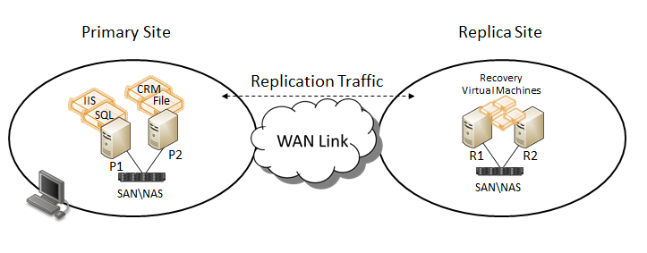

Hyper-V Replica is new functionality added to the Hyper-V Role in Windows Server 2012.  Hyper-V Replica enables organizations to implement an affordable Business Continuity and Disaster Recovery (BCDR) solution for virtualized workloads. This allows virtual machines running at a primary site to be efficiently replicated to secondary location (Replica site) across a WAN link.  

## **Purpose/Benefits**

Hyper-V Replica provides a storage-agnostic and workload-agnostic solution that replicates efficiently, periodically, and asynchronously over IP-based networks, typically to a remote site. Hyper-V Replica allows a Hyper-V Administrator, in the event of a failure at a primary site (e.g. fire, natural disaster, power outage, server failure etc…), to execute a failover of production workloads to replica servers at a secondary location within minutes, thus incurring minimal downtime.  The configurations at each site do not have to be the same with respect to server or storage hardware. Hyper-V Replica provides a System Administrator the option to restore virtualized workloads to a point in time depending on the Recovery History selections for the virtual machine.  Hyper-V Replica provides the necessary management APIs that enable IT management vendors to build an enterprise class Disaster Recovery (DR) solution for their customers. Hyper-V Replica enables Infrastructure as a Service (IaaS) for hosting providers that host dedicated/virtual servers for their customers. With Hyper-V Replica, Hosters can provide solutions that offer DR as a service to their customers (specifically Small and Medium Business (SMB) customers).  

Here is a list of terms that are relevant to the Hyper-V Replica functionality:
<table cellpadding="0" cellspacing="0" border="1" >
<tbody >
<tr >

<td bgcolor="#33FF00" width="326" valign="top" >

**Term**

</td>

<td bgcolor="#33FF00" width="437" valign="top" >

**Definition**

</td>
</tr>
<tr >

<td width="326" valign="top" >**Recovery Time Objective (RTO)**
</td>

<td width="437" valign="top" >The Recovery Time Objective (RTO) is the duration of time within which a business process must be restored after a disaster (or disruption) in order to avoid unacceptable consequences associated with a break in business continuity.  This can also be referred to in business terms as a Service Level Agreement (SLA)
</td>
</tr>
<tr >

<td width="326" valign="top" >

**Recovery Point Objective (RPO)**

</td>

<td width="437" valign="top" >The Recovery Point Objective (RPO) describes the acceptable amount of data loss measured in time
</td>
</tr>
<tr >

<td width="326" valign="top" >

**Application-consistent Replica**

</td>

<td width="437" valign="top" >Recovery to a point-in-time that is consistent from the application’s perspective.  To accomplish this, the Volume Shadow Copy Service (VSS) is used
</td>
</tr>
<tr >

<td width="326" valign="top" >

**Standard Replica**

</td>

<td width="437" valign="top" >A crash consistent replica of the primary virtual machine
</td>
</tr>
<tr >

<td width="326" valign="top" >

**Primary server**

</td>

<td width="437" valign="top" >The Hyper-V machine (Hyper-V Failover Cluster) that hosts virtualized production workloads
</td>
</tr>
<tr >

<td width="326" valign="top" >

**Replica  server**

</td>

<td width="437" valign="top" >The Hyper-V machine (Hyper-V Failover Cluster) that hosts the replica virtual machines for a Primary server
</td>
</tr>
<tr >

<td width="326" valign="top" >

**Planned Failover**

</td>

<td width="437" valign="top" >

A **Planned Failover** is a controlled event where an Administrator gracefully moves a virtual machine from a Primary site to a replica site

</td>
</tr>
<tr >

<td width="326" valign="top" >

**Failover**

</td>

<td width="437" valign="top" >

A **Failover** is an unplanned event where the Primary site experienced a problem and replica virtual machines had to be brought online at a replica site

</td>
</tr>
<tr >

<td width="326" valign="top" >

**Test Failover**

</td>

<td width="437" valign="top" >A process an Administrator executes on a replica virtual machine to verify it’s functionality
</td>
</tr>
</tbody>
</table>

Cheers,

**Marcos Nogueira**
[azurecentric.com](http://azurecentric.com)
Twitter: [@mdnoga](http://www.twitter.com/mdnoga)
