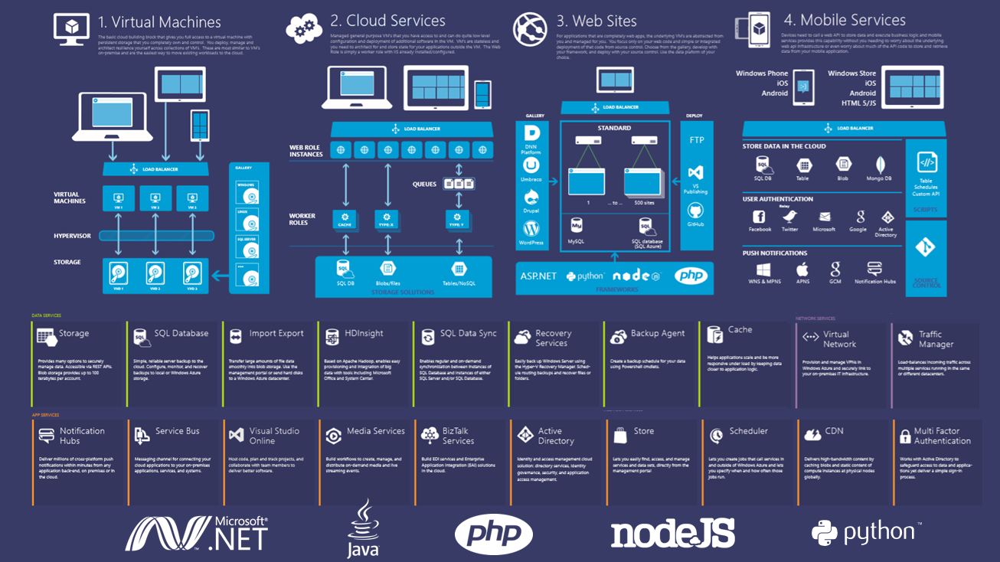

While i was doing my annual backup, i found this in the middle. This will give you a bit what are the main services that i normally use or at least a see the majority of the organizations, that i know, they are using Azure for.

In this case this is more on the ASM (classic) point of view.

Cheers,

**Marcos Nogueira**
[azurecentric.com](http://azurecentric.com)
Twitter: [@mdnoga](http://www.twitter.com/mdnoga)
