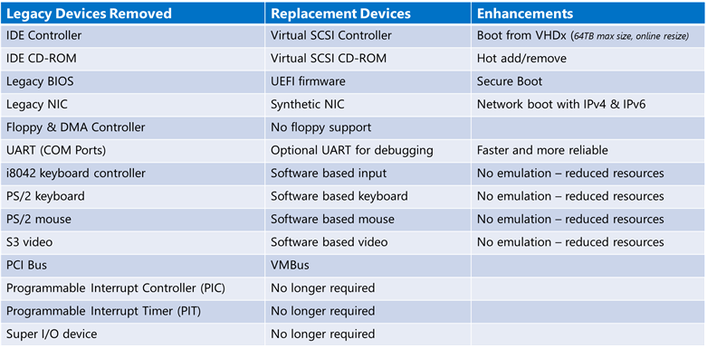
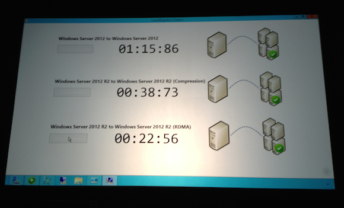

During the last TechEd North America, Microsoft wraps off what will be the new Windows Server 2012 R2. The upgrade brings an impressive number of features as well as improvements to existing capabilities in Windows Server 2012.  

Here are some of the new and improved features related to Hyper-V:  

**New Generation of Virtual Machines - Generation 2 of virtual machines**  
  * Legacy free  
  * UEFI based  
    * Many emulated devices removed  
    * Boots from virtual SCSI or synthetic network adapters  
    * Enables UEFI secure boot standard
  * Supported guest operating systems:  
    * 64-bit versions of Windows 8 and Windows Server 2012  
    * 64-bit versions of Windows 8.1 and Windows Server 2012 R2

  

**Enhanced VM Interaction - Remote Desktop over VMBus**  
  * Full remote desktop capabilities  
    * Shared clipboard  
    * Audio redirection  
    * Enhanced login  
    * and more…. 
  * Enabled even when the network is down  
  * Integrated into Hyper-V Management experience

**Automatic Activation**  
  * Zero touch activation of virtual machines  
  * Virtual machines automatically activated according to the hosting environment  
  * Reduces configuration for hosters / enterprises

**Zero-downtime upgrade**  
  * Live migrate virtual machines from   
Windows Server 2012 to Windows Server 2012 R2  
  * Includes shared nothing live migration

**Faster Live Migration**  
  * Compression  
    * Over 2x improvement in live migration time  
    * No hardware changes are required  
    * Enabled by default
  * SMB Direct  
    * Utilizes existing and new high-end networks  
    * Enables super high-speed live migrations  
    * Supports SMB Multichannel to leverage multiple interfaces

**Online VHDX resize**  
  * Increase and decrease the size of virtual hard disks – while the virtual machine is running

**Live virtual machine export / clone**  

**While the virtual machine is running…**  
  * Export a complete copy – including memory state  
  * Export any snapshot of a virtual machine

**Continuing Linux Guest Support**  
  * Full dynamic memory  
  * Online backup  
  * Online VHDX resize  
  * New video driver

**Storage QoS**  
  * Enables constant SLA delivery  
  * Dynamically configurable while the virtual machine is running  
  * Can restrict disk throughput for overactive / disruptive virtual machines

**Guest clustering with shared virtual disks**  
  * Guest Clustering  
    * Guest Clustering with commodity storage  
    * Sharing VHDX files provides shared storage for Hyper-V Failover Clustering  
    * Maintains separation between infrastructure and tenants 
  * Virtual SAS  
    * VM presented a shared virtual SAS disk  
    * Appears as shared SAS disk to VM 

**Hyper-V Replica**  
  * Extended replication  
  * Finer grained control of replication  
  * And more…

Cheers,

**Marcos Nogueira**
[azurecentric.com](http://azurecentric.com)
Twitter: [@mdnoga](http://www.twitter.com/mdnoga)
