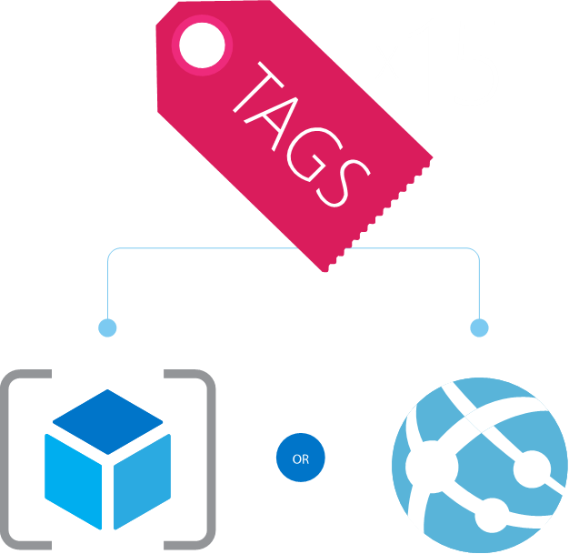

First, Tags in Azure, and almost in any other platform/application, are used to help you organize in a logical way, all the resources. So, if you have a model of subscriptions like Tier 0 ([see this post](/posts/azure-subscriptions-best-practices-part-1)) and then you have different subscriptions, where you will have all the resources (for example Production, Test and Development subscriptions) how can you organize in a logical way? For example, by department or even by application?

OK, you might think using Resource Groups. But that doesn’t have the some “power” than tags. One good example I frequently see the use of tags in Azure is for automation or for chargeback reports. I know that there is an obscene amount of way to use tags, I just mention two.

When you apply tags, you will able to retrieve the resources in your subscription with a tag key and the value. You can have the same tag across different resource groups. So, with tags in azure you can:
  * Name-value pairs assigned to individual resources or to resource groups
  * Subscription-wide taxonomy
  * Each resource can have up to 15 tags

Although tags in Azure have some limitations. These are the limitations applied to tags:
  * Each resource or resource group can have a maximum of 15 tags.
  * The tag name is limited to 512 characters.
  * The tag value is limited to 256 characters.
  * Tags applied to the resource group are not inherited by the resources in that resource group.

So, when to use tags in Azure? Please see some of the Tagging Tips
  * Notes: Simple note for VM
  * Creator: track the “owner” of a VM
  * Department/Cost center: who pays
  * Environment: production vs. pre-production vs. test

## **Resource Tags Tips**
  * Tag by environment (e.g., dev/test/prod)
  * Tag by role (e.g., web/cache/DB)
  * Tag by department (e.g., finance/retail/legal)
  * Tag by responsible party (e.g., Bob)
  * Tag for automation (e.g., autoshutdownschedule)

Cheers,

**Marcos Nogueira**
[azurecentric.com](http://azurecentric.com)
Twitter: [@mdnoga](http://www.twitter.com/mdnoga)
