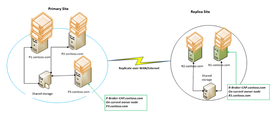

Hyper-V Replica requires the Failover Clustering role **Hyper-V Replica Broker** to be configured if either the primary or replica Hyper-V server is part of a cluster. This post builds on top of the guide and explains **_why_** the broker is required and captures its high level behavior.

The following example will be used through the rest of the article:
  * **_Cluster-P_** – Failover Cluster in city 1
  * **_P1, P2, P3 (.contoso.com)_** – names of the cluster nodes on a cluster **_Cluster-P_**
  * **_P-Broker-CAP.contoso.com_** – the client access point of the broker on **_Cluster-P_**
  * **_VirtualMachine_Workload_** – the name of the virtual machine running on **_Cluster-P_**
  * **_Cluster-R_** – Failover Cluster in city 2
  * **_R1, R2 (.contoso.com)_** – names of the cluster nodes on the **_Cluster-R_**
  * **_R-Broker-CAP.contoso.com_** – the client access point of the broker on **_Cluster-R_**



## **Unified View**
  * On **_Cluster-R_**; **_P-Broker-CAP.contoso.com_** is added to the list of authorized servers rather than adding **_P1, P2, P3 (.contoso.com) _**individually.
  * When enabling replication for any virtual machine on the primary server, the client access point of the broker on the replica server is used (and not the replica server name)
  * When a replicating virtual machine migrates within the **_Cluster-P_**, the destination server is automatically authorized to send replication      traffic
  * When new nodes are added to the **_Cluster-P_**, there is no change required on replication settings (specifically the authorization table) on **_Cluster-R_**

## **Initial Node placement**

  * When replication is enabled for the primary virtual machine, the primary server contacts **_R-Broker-CAP_**	
  * The request is authenticated and authorized. **_R-Broker-CAP _**then picks a random node fromits cluster** _Cluster-R_** after validating whether the host node is available and if the Virtual machine Management Service is running. It returns the node name (eg: R2.contoso.com) to the primary server
  * The primary server now starts replicating to this node (R2.contoso.com)

## **Making the replica virtual machine, HA**

As part of creating the replica virtual machine, the Hyper-V Replica Broker is also responsible for making the virtual machine highly available. If the node crashes, the Failover Cluster Service would move replica the Virtual machine, thereby protecting the replica Virtual machine and the replication process from host crashes on the **_Cluster-R_**.

## **Redirect traffic in case replica virtual machine migrates**

  * If the replica virtual machine migrates from one node (eg: R1.contoso.com) to another (eg: R2.contoso.com), the primary server falls back to the broker **_R-Broker-CAP_**with the question “where is the replica for the virtual machine **_VirtualMachine_Workload_**”
  * The broker locates the virtual machine in the cluster and returns the node name (R2.contoso.com) to the primary server.
  * The primary server sends its subsequent requests to R2.contoso.com – the replication is re-established with no manual intervention.

## **Provide centralized management of the replication settings**

  * For a cluster on the replica site, the replication settings are configured via the Replication Settings which is available on clicking the Broker role in the Failover cluster console.
  * The Broker role  writes the replication configuration to the cluster database and triggers a notification.
  * Virtual machine Management Service on each node picks up the configurations and each node is now working with the latest copy of the replication settings.

## **Configure the Broker using PS cmdlet**

* Issue the following cmdlets to configure the broker:
```powershell
$BrokerName = “P-Broker-CAP”
Add-ClusterServerRole -Name $BrokerName
Add-ClusterResource -Name “Virtual Machine Replication Broker” -Type "Virtual Machine Replication Broker" -Group $BrokerName
Add-ClusterResourceDependency “Virtual Machine Replication Broker” $BrokerName
Start-ClusterGroup $BrokerName
```

Cheers,

**Marcos Nogueira**
[azurecentric.com](http://azurecentric.com)
Twitter: [@mdnoga](http://www.twitter.com/mdnoga)
