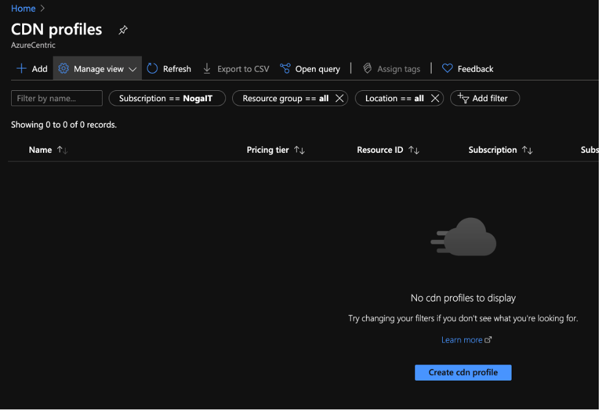
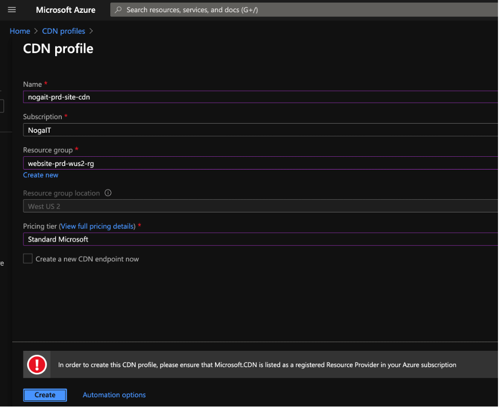
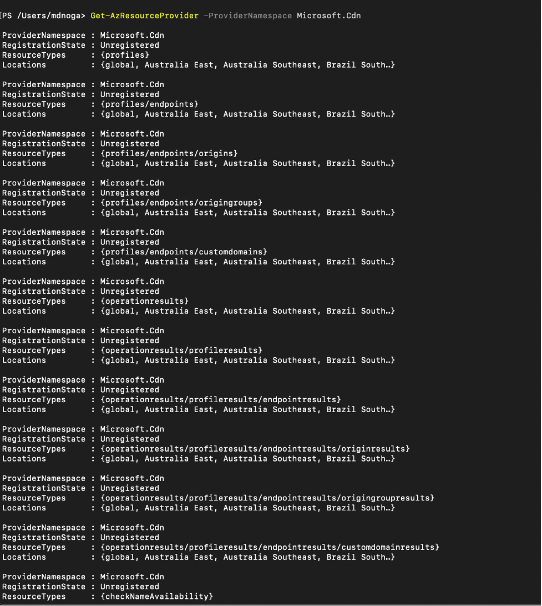
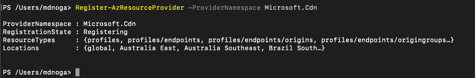

Hoje estava a criar um Azure CDN Profile para poder fazer o deploy de conteúdo estático em várias regiões do Azure. Fui ao Azure Portal e iniciei o processo. O primeiro passo é criar o CDN Profile. Neste caso nunca tinha usado o CDN nesta subscrição, como se vê na imagem abaixo.

 

No entanto, durante o processo de criação do CDN Profile, depois de clicar no botão Create, o Azure valida se está tudo em ordem. Neste caso obtive o erro mostrado na imagem abaixo.

>In order to create this CDN profile, please ensure that Microsoft.CDN is listed as a registered Resource Provider in your Azure subscription

 

## O que significa isto?
Significa que nem todos os Azure Resource Providers disponíveis para este tipo de subscrição estão registados ou sequer disponíveis. Consoante o tipo de subscrição, pode haver Resource Providers que nem estão disponíveis para utilização ou, como neste caso, para registo.

No caso do Resource Provider do CDN foi simples verificar com o cmdlet de PowerShell
```powershell
Get-AzResourceProvider -ProviderNamespace Microsoft.Cdn
```
 


Depois de confirmar que o Resource Provider está "Unregistered", basta correr o cmdlet de PowerShell para o registar

```powershell
Register-AzResourceProvider -ProviderNamespace Microsoft.Cdn
```


 
A partir daí consegui prosseguir com a configuração do CDN sem problemas.

Um abraço,

**Marcos Nogueira**  
**_Azure MVP_**  
[azurecentric.com](http://azurecentric.com)  
Twitter: [@mdnoga](http://www.twitter.com/mdnoga)
